# C4 Component Relationships

## Generated By
- **Agent**: c4-component (Gemini CLI)
- **Run ID**: c4-2026-05-21-001
- **Generated**: 2026-05-21T00:00:00Z

## Domain Components Diagram

```mermaid
C4Component
    title vQA Component Dependencies

    Container_Boundary(vqa_backend, "vQA Backend") {
        Component(core, "vQA Backend Core", "Application", "FastAPI bootstrap, config, secrets, CLI runner")
        Component(api, "API Layer", "Boundary", "REST + WebSocket endpoints, auth, run state")
        Component(engine, "LangGraph Engine", "Domain Module", "State machine: AC parse, See-Think-Act-Verify, HITL, audit report")
        Component(browser, "Browser Automation", "Service", "Playwright lifecycle, screenshots, ARIA tree, SoM, click-teach")
        Component(kb, "Knowledge Base", "Service", "TF-IDF RAG, selector/component registry, interaction blueprints")
        Component(memory, "Memory System", "Service", "SQLite persistent memory, few-shot examples, skill library, KB proposals")
        Component(profiles, "Profile System", "Service", "AppProfile plugin registry: auth flows, roles, DOM sync, identity")
        Component(storage, "Storage", "Service", "S3 artifact bridge, SQLite run history + suites, pluggable run state")
        Component(adapters, "Test Source Adapters", "Boundary Adapter", "Jira + GitHub + raw-text AC fetch")
        Component(llm, "LLM Provider", "Library", "Bedrock factory: purpose-specific defaults, tiered Haiku/Sonnet routing")
    }

    Container_Boundary(react_frontend, "React Frontend") {
        Component(dashboard, "React Dashboard", "UI Module", "SPA: execution control, live monitoring, HITL, triage, analytics, reports")
    }

    System_Ext(jira, "Jira", "Ticket source and comment target")
    System_Ext(github, "GitHub", "Issue source (AC ingestion)")
    System_Ext(bedrock, "AWS Bedrock", "LLM inference — Claude Haiku + Sonnet via Converse API")
    System_Ext(s3, "AWS S3", "Artifact storage: screenshots, video, HTML reports")
    System_Ext(ssm, "AWS SSM", "Encrypted credential store")
    System_Ext(redis, "Redis (optional)", "Distributed run state for multi-container deployments")

    %% React Dashboard → API Layer
    Rel(dashboard, api, "Calls REST endpoints", "HTTPS / JSON")
    Rel(dashboard, api, "Streams run events", "WebSocket")

    %% vQA Backend Core → dependents
    Rel(core, api, "Registers REST + WebSocket routers", "In-process")
    Rel(core, browser, "Drains BrowserManagers on shutdown", "In-process")
    Rel(core, engine, "Registers WS broadcaster via human_takeover.set_ws_broadcaster()", "In-process")
    Rel(core, kb, "Reads/rewrites human_guidance.md (dedup utility)", "Filesystem")
    Rel(core, ssm, "Resolves secrets at startup", "HTTPS / AWS SDK")

    %% API Layer → engine + supporting components
    Rel(api, engine, "build_graph() + astream() — launches test runs", "In-process")
    Rel(api, browser, "HITL: inject actions, capture screenshots", "In-process")
    Rel(api, kb, "Teach: write selector + guidance", "In-process")
    Rel(api, memory, "KB proposals endpoint; Teach: record outcomes", "In-process")
    Rel(api, storage, "Run history, analytics, suite CRUD, run state read/write", "In-process")
    Rel(api, adapters, "Fetch tickets (Jira board), validate connectivity, post comments", "In-process")
    Rel(api, profiles, "Verify profile registry health", "In-process")

    %% LangGraph Engine → supporting components
    Rel(engine, browser, "Screenshots, ARIA tree, Playwright dispatch, network sync", "Async in-process")
    Rel(engine, kb, "RAG queries for planning, selector hints", "Async in-process")
    Rel(engine, memory, "Few-shot examples, skill retrieval, record outcome", "Async in-process")
    Rel(engine, profiles, "Load AppProfile for login, roles, DOM sync, prompt identity", "In-process")
    Rel(engine, storage, "Upload screenshots, video, report; record run; run state updates", "Async in-process")
    Rel(engine, adapters, "Fetch ticket at run start; post completion comment", "In-process")
    Rel(engine, llm, "get_llm(purpose, heavy) — planner, verifier, parser, evaluator, supervisor", "In-process")

    %% Browser Automation → Storage (screenshot upload)
    Rel(browser, storage, "upload_bytes() for screenshot audit trail", "In-process")

    %% Storage → external
    Rel(storage, s3, "PutObject screenshots, video, HTML reports", "HTTPS / boto3")
    Rel(storage, redis, "Distributed run state (optional)", "TCP")

    %% Test Source Adapters → external
    Rel(adapters, jira, "Ticket fetch, board listing, comment posting", "HTTPS / REST")
    Rel(adapters, github, "Issue fetch + comment scan", "HTTPS / REST")

    %% LLM Provider → external
    Rel(llm, bedrock, "ChatBedrockConverse inference — Haiku + Sonnet", "HTTPS / langchain_aws")
```

## Cross-Component Edges

| From | To | Pattern | Notes |
|------|----|---------|-------|
| React Dashboard | API Layer | REST call | All 16 REST endpoints consumed by dashboard hooks |
| React Dashboard | API Layer | WebSocket stream | `WS /ws/{runId}` — 7 inbound message types |
| vQA Backend Core | API Layer | In-process registration | `main.py` mounts `router` + `ws_router` from `routes.py` |
| vQA Backend Core | Browser Automation | In-process shutdown | `get_all_managers()` drain on FastAPI lifespan shutdown |
| vQA Backend Core | LangGraph Engine | In-process startup | `set_ws_broadcaster()` called in lifespan startup |
| vQA Backend Core | Knowledge Base | Filesystem write | `dedup_kb.py` rewrites `knowledge/human_guidance.md` |
| API Layer | LangGraph Engine | In-process async | `build_graph()` + `astream()` per test run; cancellation via flag |
| API Layer | Browser Automation | In-process HITL | `get_manager()`, `highlight_and_screenshot()`, `build_element_label()` |
| API Layer | Knowledge Base | In-process write | Teach writes via HITL (human_guidance.md) |
| API Layer | Memory System | In-process | `persistent_memory.propose_kb_updates()` (KB proposals endpoint) |
| API Layer | Profile System | In-process | Profile validation and capability discovery |
| API Layer | Storage | In-process | Run history/analytics reads; suite CRUD; run state get/update; S3 health check |
| API Layer | Test Source Adapters | In-process | Jira ticket list cache, credential pre-check, comment post |
| LangGraph Engine | Browser Automation | Async in-process | Screenshot, ARIA tree, Playwright dispatch, network sync, SoM, click-teach |
| LangGraph Engine | Knowledge Base | Async in-process | TF-IDF RAG (plan, failure, preflight), selector hints |
| LangGraph Engine | Memory System | Async in-process | Few-shot examples, skill query, outcome recording |
| LangGraph Engine | Profile System | In-process | `get_active_profile()` for login sequence, roles, DOM sync, prompt identity |
| LangGraph Engine | Storage | Async in-process | `upload_video`, `upload_report`, `run_history.record_run`, run state updates, S3 screenshot uploads |
| LangGraph Engine | Test Source Adapters | In-process | `fetch_ticket_context()` at run start; `post_jira_comment()` on completion |
| LangGraph Engine | LLM Provider | In-process | `get_llm(purpose)` called from graph, verifier, evaluator, supervisor, failure_analyzer |
| Browser Automation | Storage | In-process | `upload_bytes()` for screenshot persistence to S3 |

## Cross-References
- **Master Index**: [`c4-component.md`](./c4-component.md)
- **Container topology**: [`c4-container-relationships.md`](./c4-container-relationships.md)
