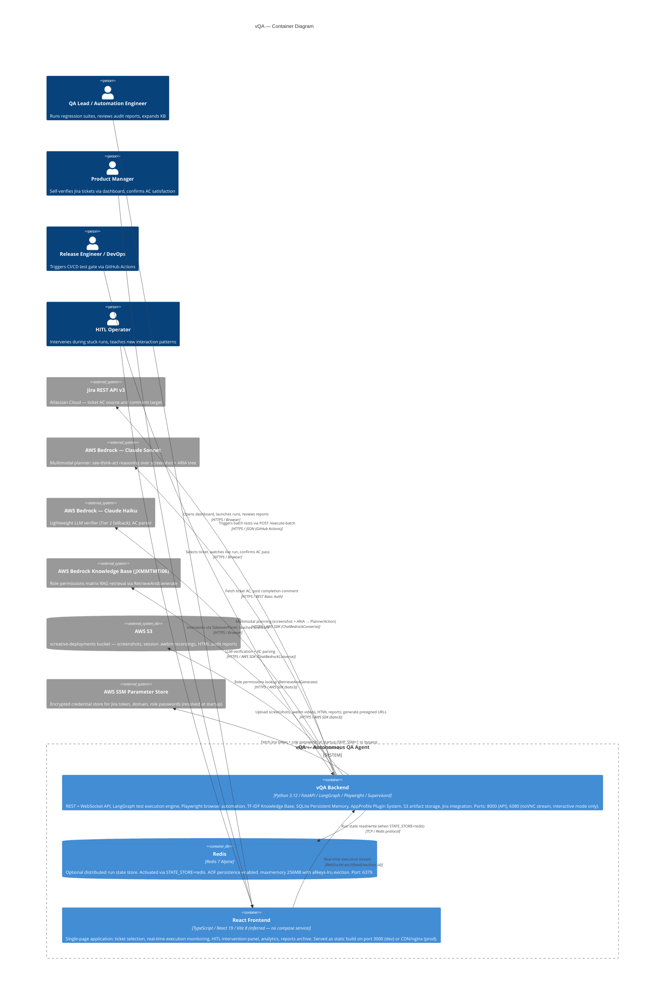

# C4 Container Relationships

<!--
  Auto-generated by the c4-container agent (master mode). Holds the system-wide
  Mermaid C4Container diagram(s) plus the cross-container communication matrix.

  Lives in its own file to keep c4-container.md (the master index) lean. When
  there are >10 containers, the diagram is split into multiple sub-diagrams
  (primary user-facing + supporting infrastructure). This system has 4 containers
  (3 IaC-backed + 1 inferred) — the single primary diagram covers everything.

  HAND-AUTHORED CONTENT: this file has TWO USER-MANAGED blocks for hand-curated
  external integrations and edges the agents may have missed. Content between
  USER-MANAGED markers is preserved verbatim. For content OUTSIDE marker blocks,
  the agent uses the approval gate (writes .proposed.md + .pending-approval.md
  if regeneration would remove or materially alter existing entries).
-->

## Generated By

- **Agent**: c4-container (Gemini CLI)
- **Run ID**: c4-2026-05-21-001
- **Generated**: 2026-05-21T00:00:00Z

## Primary Container Diagram

<!--
  System-wide topology. All 4 containers plus external systems and personas.
  Supporting Containers Diagram is OMITTED — system has ≤10 containers.
-->

## Cross-Container Communication Matrix

<!--
  One row per directed cross-container edge.
-->

| From | To | Protocol | Pattern | Notes |
|------|----|---------|---------|-------|
| React Frontend | vQA Backend | HTTPS / JSON | Sync request-response | All REST calls use VITE_API_URL (default http://localhost:8000); protected by X-VQA-API-Key header |
| React Frontend | vQA Backend | WebSocket | Async stream | WS /ws/{run_id}; unauthenticated at WebSocket level; connected after POST /execute returns run_id |
| vQA Backend | Redis | TCP / Redis protocol | Sync key-value | Only active when STATE_STORE=redis env var; default is in-memory (no Redis dependency) |

## External-System Edges (System Boundary Crossings)

<!--
  Where the system meets the outside world. Each row identifies the container
  that originates or terminates the edge.
-->

| Container | External System | Direction | Protocol | Critical Path? |
|-----------|----------------|-----------|---------|----------------|
| vQA Backend | Jira REST API v3 (Atlassian Cloud) | Outbound | REST / HTTPS / Basic Auth | Yes — required for AC ingestion; runs fail without Jira connectivity |
| vQA Backend | AWS Bedrock — Claude Sonnet | Outbound | HTTPS / AWS SDK (ChatBedrockConverse) | Yes — multimodal planner; runs cannot proceed without Bedrock |
| vQA Backend | AWS Bedrock — Claude Haiku | Outbound | HTTPS / AWS SDK (ChatBedrockConverse) | No — degraded mode possible (Tier 1 programmatic verification covers most cases) |
| vQA Backend | AWS Bedrock Knowledge Base (JXMMTMTI06) | Outbound | HTTPS / AWS SDK (boto3 RetrieveAndGenerate) | No — role permissions lookup; env-var fallback available |
| vQA Backend | AWS S3 | Outbound | HTTPS / AWS SDK (boto3 PutObject/GetObject) | No — artifact persistence is independent; run completes even if S3 upload fails |
| vQA Backend | AWS SSM Parameter Store | Outbound | HTTPS / AWS SDK (boto3) | No — startup-time only; SKIP_SSM=1 bypasses for local development |

<!-- USER-MANAGED-START: additional-external-integrations -->

### Additional External Integrations (User-Managed)

<!--
  Hand-add external integrations the agents missed (message buses, webhooks,
  event sources, file-transfer integrations, etc.). Content between USER-MANAGED
  markers is preserved verbatim.

  Tip: consider adding the integration to memory-bank/productBrief.md § Integration
  Points instead — that section is canonical and the agents auto-include those
  entries on every run.

  | Container | External System | Direction | Protocol | Critical Path? | Notes |
-->

(empty by default)

<!-- USER-MANAGED-END: additional-external-integrations -->

<!-- USER-MANAGED-START: additional-edges -->

### Additional Cross-Container Edges (User-Managed)

<!--
  Hand-add cross-container edges the agents missed. Same schema as the matrix
  above. Preserved verbatim across regenerations.
-->

(empty by default)

<!-- USER-MANAGED-END: additional-edges -->

## Boundary Infrastructure

<!--
  Non-container IaC resources recorded for awareness. These do NOT generate
  C4 containers. For this project the only IaC source is docker-compose; boundary
  resource types (IAM, VPC, Route53, etc.) are managed outside the repo.
  Compose-specific boundary items are listed below.
-->

| Resource Type | Count | IaC Sources | Note |
|---------------|-------|-------------|------|
| Docker volume mount (`./volumes/recordings`) | 1 | `docker/docker-compose.yml:106` | Persists browser session video recordings to host for debugging |
| Docker volume mount (`./volumes/screenshots`) | 1 | `docker/docker-compose.yml:108` | Persists screenshot files to host for debugging |
| Docker volume mount (`./volumes/auth-states`) | 1 | `docker/docker-compose.yml:110` | Persists Playwright auth state files across container restarts |
| Docker volume mount (`./volumes/memory`) | 1 | `docker/docker-compose.yml:112` | Persists SQLite DBs (run_history.db, test_suites.db, learned_patterns.db) + skills.jsonl |
| Docker volume mount (`./volumes/redis-data`) | 1 | `docker/docker-compose.yml:141` | Persists Redis AOF data across container restarts |
| Docker `shm_size` override (2gb) | 1 | `docker/docker-compose.yml:100` | Chromium requires >64MB /dev/shm; set to 2GB for video recording |
| Docker `deploy.resources` limits | 1 | `docker/docker-compose.yml:88` | Backend: 4GB RAM / 2 CPU limit; 2GB / 1 CPU reservation |
| Docker health check (`/health`) | 2 | `docker/docker-compose.yml:117`, `docker/Dockerfile:107` | Liveness probe for compose orchestration and Docker health status |
| GitHub Actions `workflow_call` trigger | 1 | `.github/workflows/vqa-test.yml:8` | Reusable CI workflow consumed by downstream pipelines; not a runtime container |
| `.env` file (secrets boundary) | 1 | Referenced by both compose files | Contains Jira credentials, AWS keys, role passwords — never committed; AWS SSM is the production alternative |

(This section captures Docker operational boundaries, not cloud infrastructure boundaries, as the only IaC in this repo is Docker Compose.)

## Cross-References

- **Master Index**: [`c4-container.md`](./c4-container.md)
- **Per-container detail**: [`containers/`](./containers/)
- **System Context**: [`c4-context.md`](./c4-context.md) (non-technical view)
- **IaC adapter rules**: `context/c4-iac-adapters.md` (recognition rules used to produce the boundary list)
