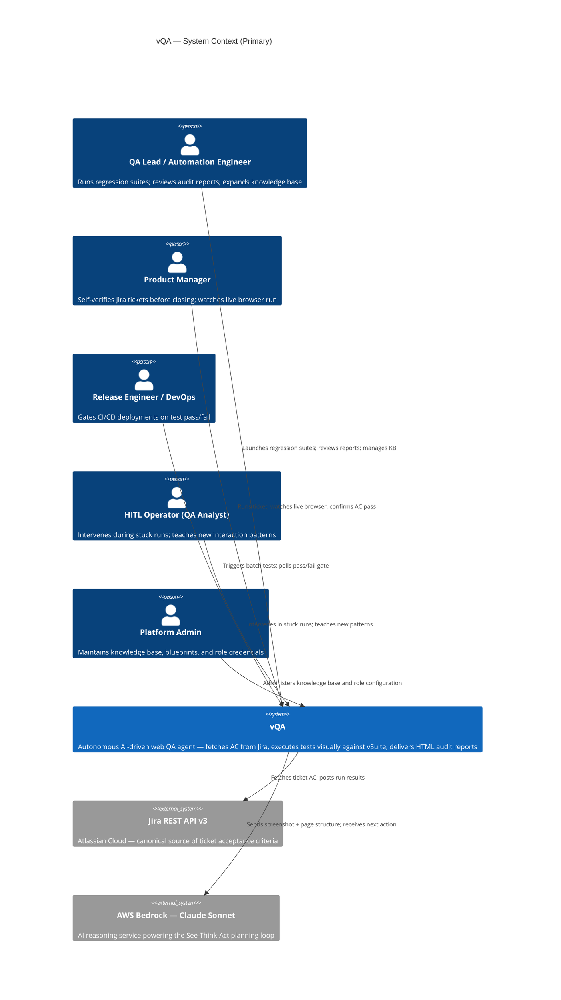
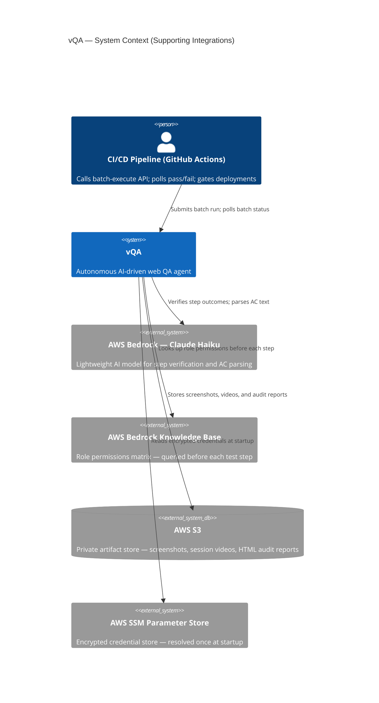

# C4 Context Level: System Context

<!--
  Auto-generated by the c4-context agent. Highest-level view of the system.
  Refreshed on /vc-c4 reruns when containers or productBrief.md change.

  Per the C4 model, this level focuses on PEOPLE and SOFTWARE SYSTEMS, not
  technology. Tech-stack details belong in c4-container.md.

  HAND-AUTHORED CONTENT PRESERVATION:

  Two preservation mechanisms work together:

  1. USER-MANAGED markers (preferred): place hand-authored content between
     <!-- USER-MANAGED-START: <id> --> ... <!-- USER-MANAGED-END: <id> -->
     blocks. The c4-context agent preserves these blocks verbatim across
     regenerations. This file declares two such blocks below: "additional-
     personas" and "additional-external-integrations".

  2. Approval gate: for content OUTSIDE marker blocks, the agent compares
     each regeneration against the existing file. If it would REMOVE or
     materially ALTER existing entries, it writes proposed content to
     c4-context.md.proposed.md and a diff report to
     c4-context.md.pending-approval.md, and the orchestrator prompts the
     user before finalizing. Use --accept-all / --reject-all to bypass
     prompting in CI.

  See context/c4-external-integrations.md for the Material-Change Taxonomy
  that determines what counts as a material alteration.
-->

## Generated By

- **Agent**: c4-context (Sonnet)
- **Run ID**: c4-2026-05-08-001
- **Generated**: 2026-05-08T00:00:00Z
- **Synthesized From**: c4-container.md (lean index), c4-container-relationships.md (cross-container matrix + external-system edges), containers/c4-container-vqa-backend.md + c4-container-react-frontend.md (per-container detail), productBrief.md, techContext.md (light), systemPatterns.md

## System Overview

### Short Description

vQA is an autonomous AI-driven web QA agent that fetches Acceptance Criteria from Jira tickets, executes them visually against a live browser, and delivers self-contained audit reports — eliminating hand-written test scripts and selector maintenance.

### Long Description

vQA exists to solve a persistent pain point for the vProMedia engineering and operations teams: manual QA test scripts that break every sprint when the vSuite application's user interface changes. Rather than requiring QA engineers to maintain hundreds of CSS selectors and hand-authored scripts, vQA reads the team's existing Jira tickets as its test specification and reasons about the live browser the same way a human QA analyst would — by looking at what is visually on screen and what the page's structure tells it, then deciding what action to take next.

The system serves five distinct groups within the vProMedia organization. QA engineers and automation leads use it to run full regression suites without touching test code between sprints. Product managers use it to self-verify a ticket before closing it, watching the live browser execute each acceptance criterion step by step. Release engineers and DevOps teams use it to gate staging deployments in CI/CD pipelines — a batch run either passes and the deployment proceeds, or it fails and the pipeline is blocked. QA analysts on-call during a run can intervene when the agent gets stuck, teach it a new interaction pattern, and watch it resume. Platform administrators maintain the knowledge base that makes the agent progressively smarter across sprints.

vQA is purpose-built for the vProMedia internal tooling stack. It is not a general-purpose commercial test platform, it is not sold externally, and it has no multi-tenancy or billing layer. Its competitive advantage is institutional knowledge: every human intervention is permanently learned and fed back into the agent's knowledge base, so the system improves with use.

What vQA explicitly does NOT do: it does not replace manual exploratory testing for brand-new workflows; it does not manage Jira tickets (it reads from but does not own them); and it does not persist vSuite user data — screenshots and session recordings captured during a run are stored in a private artifact store and are intended only for internal engineering use.

## Personas

<!--
  Personas are sourced from memory-bank/productBrief.md when present. The c4-context
  agent enriches them with system-specific journey hints derived from container
  interfaces, but the canonical persona definitions live in productBrief.md.

  Hand-add personas the agents missed in the User-Managed block below this section.
-->

### QA Lead / Automation Engineer

- **Type**: Human User
- **Description**: Senior QA professional who owns the regression suite. Responsible for ensuring test coverage across rapid UI sprints without spending 30-40% of sprint time patching broken selectors.
- **Goals**: Run fully autonomous regression suites; keep HITL escalation rate below 20%; produce audit reports credible enough to share with engineering as evidence of quality.
- **Key Features Used**: Regression suite execution, audit report review, knowledge base administration, HITL intervention, Click-to-Teach KB training
- **Source**: productBrief.md § Key Personas

### Product Manager

- **Type**: Human User
- **Description**: PM who owns vSuite tickets and wants to self-verify that a ticket's acceptance criteria are satisfied before marking it "Done" — without waiting for a full QA cycle.
- **Goals**: Run a single-ticket test, watch it pass live in the browser, and close the ticket with visual confirmation rather than a green checkbox.
- **Key Features Used**: Single-ticket interactive run, live browser streaming, AC step preview, run status monitoring
- **Source**: productBrief.md § Key Personas

### Release Engineer / DevOps

- **Type**: Human User (and Programmatic User via CI/CD pipeline)
- **Description**: CI/CD pipeline owner responsible for gating staging deployments. May trigger vQA directly from the pipeline rather than through the dashboard.
- **Goals**: Every staging deploy is automatically gated on a passing test run; failed runs block the merge; no manual QA bottleneck in the deployment path.
- **Key Features Used**: Batch test execution, batch status polling, CI/CD pipeline integration
- **Source**: productBrief.md § Key Personas

### Human-in-the-Loop Operator (QA Analyst)

- **Type**: Human User
- **Description**: QA analyst who monitors live runs and intervenes when the agent gets stuck — either injecting a browser action directly or using Click-to-Teach mode to capture a new selector for the knowledge base.
- **Goals**: Unblock stuck runs quickly; teach the agent new interaction patterns that will be retained permanently; see the agent resume and complete the step autonomously.
- **Key Features Used**: HITL intervention panel, Click-to-Teach KB training, live browser streaming, run status monitoring
- **Source**: productBrief.md § Key Personas

### Platform Admin / vProMedia Engineering

- **Type**: Human User
- **Description**: Engineer who maintains the vQA system itself — expanding the knowledge base, writing interaction blueprints for new vSuite workflows, managing role credentials, and diagnosing blind spots when new UI components are introduced.
- **Goals**: Keep the knowledge base current as vSuite evolves; ensure all vSuite user roles have working credentials; introduce new workflow coverage without requiring code changes.
- **Key Features Used**: Knowledge base management, role credential configuration, blueprint authoring, KB sync pipeline
- **Source**: productBrief.md § Key Personas

### CI/CD Pipeline (GitHub Actions)

- **Type**: Programmatic User
- **Description**: Automated pipeline that calls the vQA batch execution API as part of a deployment workflow. Polls batch status to determine pass/fail and gates the deployment accordingly.
- **Goals**: Receive a deterministic pass/fail signal from vQA for each staging deployment; block or proceed based on test results.
- **Key Features Used**: Batch test execution, batch status polling, health check
- **Source**: inferred from container interfaces (vQA Backend § Interfaces — `POST /execute-batch`, `GET /batch-status/{batch_id}`); reinforced by productBrief.md § APIs Provided and systemPatterns.md § Execution Mode Split (headless batch mode). Recommend verifying in productBrief.md § Key Personas.

<!-- USER-MANAGED-START: additional-personas -->

### Additional Personas (User-Managed)

<!--
  Hand-add personas the agents missed. Content between the USER-MANAGED markers
  is preserved verbatim across regenerations. Use the same structure as the
  agent-generated personas above (Type / Description / Goals / Key Features Used /
  Source).
-->

(empty by default — add hand-curated personas here, then they're permanently preserved)

<!-- USER-MANAGED-END: additional-personas -->

## System Features

<!--
  High-level features visible to personas. Map each feature to the container(s)
  that implement it (without naming tech).
-->

### Single-Ticket Interactive Test Run

- **Description**: A user selects a Jira ticket and a user role from the dashboard, optionally previews the parsed acceptance-criteria steps, and launches a test run. The agent logs in as the selected role, executes each AC step visually, and the user watches the live browser and step-by-step progress in real time.
- **Users**: Product Manager, QA Lead / Automation Engineer
- **Implementing Containers**: React Frontend (operator UI), vQA Backend (execution engine)
- **User Journey**: No journey doc exists — gap. Recommended next step: `/vc-creative` or hand-author `memory-bank/creative/TASK-XXX-single-ticket-run-user-journey.md`.

### Batch Regression Suite Execution

- **Description**: Multiple Jira tickets are submitted in a single batch request. The agent runs each ticket autonomously in parallel, producing individual pass/fail results and a consolidated batch status that callers can poll.
- **Users**: QA Lead / Automation Engineer, Release Engineer / DevOps, CI/CD Pipeline
- **Implementing Containers**: vQA Backend
- **User Journey**: No journey doc exists — gap. Recommended next step: hand-author `memory-bank/e2e-journeys/batch-regression-run.md`.

### Live Browser Streaming

- **Description**: During an interactive run, the live browser is streamed directly into the dashboard as the agent executes. Users see exactly what the agent sees — every click, page load, and form fill — as it happens.
- **Users**: Product Manager, Human-in-the-Loop Operator, QA Lead / Automation Engineer
- **Implementing Containers**: vQA Backend (virtual display pipeline), React Frontend (embedded viewer)
- **User Journey**: No journey doc exists — gap.

### Human-in-the-Loop (HITL) Intervention

- **Description**: When the agent gets stuck on an AC step it cannot resolve, it pauses and broadcasts a takeover signal. An on-call operator sees the stuck state, takes control of the browser directly from the dashboard, completes the step, and signals the agent to resume. The action the operator performed is recorded as a new interaction pattern.
- **Users**: Human-in-the-Loop Operator
- **Implementing Containers**: React Frontend (TakeoverPanel), vQA Backend (HITL pause/resume)
- **User Journey**: No journey doc exists — gap. Recommended next step: `/vc-creative` or hand-author `memory-bank/creative/TASK-XXX-hitl-intervention-user-journey.md`.

### Click-to-Teach Knowledge Base Training

- **Description**: While in the HITL takeover panel, an operator can switch to Click-to-Teach mode, click an element in the live browser, and have the system automatically capture the element's selector and save it — along with optional guidance text — directly to the knowledge base. Learned patterns are immediately available for future runs.
- **Users**: Human-in-the-Loop Operator, Platform Admin / vProMedia Engineering
- **Implementing Containers**: React Frontend (Click-to-Teach panel), vQA Backend (selector capture + KB persistence)
- **User Journey**: No journey doc exists — gap.

### Audit Report Delivery

- **Description**: At the end of every run the system produces a self-contained HTML audit report containing per-step screenshots, agent reasoning text, the locator used, and a pass/fail verdict for each acceptance criterion. Reports are stored in the artifact store and accessible via a presigned link that works without backend connectivity.
- **Users**: QA Lead / Automation Engineer, Product Manager, Release Engineer / DevOps
- **Implementing Containers**: vQA Backend (report generation + artifact storage)
- **User Journey**: No journey doc exists — gap.

### Run History and Analytics

- **Description**: The dashboard exposes historical run data — pass rates, cost-per-run trends, most-tested tickets, and top failure categories — over configurable time windows. Operators use this to track regression coverage and identify knowledge-base blind spots.
- **Users**: QA Lead / Automation Engineer, Platform Admin / vProMedia Engineering
- **Implementing Containers**: React Frontend (analytics views), vQA Backend (history + analytics API)
- **User Journey**: No journey doc exists — gap.

### CI/CD Deployment Gate

- **Description**: The system exposes a headless batch execution endpoint that CI/CD pipelines call programmatically. The pipeline polls batch status; a failing batch blocks the deployment. This provides an automated regression gate without a human in the loop.
- **Users**: Release Engineer / DevOps, CI/CD Pipeline
- **Implementing Containers**: vQA Backend
- **User Journey**: No journey doc exists — gap. Recommended next step: hand-author `memory-bank/e2e-journeys/ci-deployment-gate.md`.

### Knowledge Base Management

- **Description**: Platform admins can expand the agent's knowledge by adding new interaction blueprints for vSuite workflows, extending the selector registry, and editing the human-guidance document. A sync command pushes updated guidance to the cloud knowledge store, where it becomes immediately available to the planning engine on subsequent runs.
- **Users**: Platform Admin / vProMedia Engineering
- **Implementing Containers**: vQA Backend (KB sync + RAG pipeline)
- **User Journey**: No journey doc exists — gap.

### Role-Based Access Control (RBAC) Testing

- **Description**: The system supports executing the same acceptance criteria from eight distinct vSuite user roles in a single run. Role-switching is fully automated — the agent logs in as each role and validates that the expected permissions and restrictions are respected, surfacing RBAC violations automatically.
- **Users**: QA Lead / Automation Engineer, Product Manager
- **Implementing Containers**: vQA Backend (role credential management + test execution)
- **User Journey**: No journey doc exists — gap.

## User Journeys

<!--
  No journey docs were found in memory-bank/creative/ or memory-bank/e2e-journeys/.
  Neither directory exists in this repository as of the current run.

  Every feature listed above is a journey gap. Recommended path:
  - Run `/vc-creative` for the most important interactive flows (single-ticket run, HITL intervention)
  - Hand-author lightweight journey docs for the programmatic / CI-only flows (batch execution, deployment gate)
-->

| Feature | Journey Doc | Status |
|---------|-------------|--------|
| Single-Ticket Interactive Test Run | — | Gap — no journey doc exists |
| Batch Regression Suite Execution | — | Gap — no journey doc exists |
| Live Browser Streaming | — | Gap — no journey doc exists |
| Human-in-the-Loop (HITL) Intervention | — | Gap — no journey doc exists |
| Click-to-Teach Knowledge Base Training | — | Gap — no journey doc exists |
| Audit Report Delivery | — | Gap — no journey doc exists |
| Run History and Analytics | — | Gap — no journey doc exists |
| CI/CD Deployment Gate | — | Gap — no journey doc exists |
| Knowledge Base Management | — | Gap — no journey doc exists |
| Role-Based Access Control (RBAC) Testing | — | Gap — no journey doc exists |

**Recommended next steps:**
- `/vc-creative` for high-value interactive journeys: single-ticket run (Product Manager), HITL intervention (QA Analyst)
- Hand-author for programmatic flows: CI/CD deployment gate (`memory-bank/e2e-journeys/ci-deployment-gate.md`), batch regression run (`memory-bank/e2e-journeys/batch-regression-run.md`)

## External Systems and Dependencies

### Jira REST API v3 (Atlassian Cloud)

- **Type**: API
- **Description**: Atlassian-hosted issue tracker that is the canonical source of acceptance criteria. vQA reads ticket summaries and AC from Jira and, after a run, can post the triage result as a comment on the originating ticket.
- **Integration Type**: REST API (outbound, Basic Auth)
- **Critical Path?**: Yes — the system cannot start a test run without fetching AC from Jira. All runs fail if Jira is unreachable.
- **Owned By**: Atlassian (vendor) — credentials managed by vProMedia Platform Admin
- **Sources**: productBrief.md § Integration Points; reinforced by techContext.md § External Services, c4-container-relationships.md § External-System Edges

### AWS Bedrock — Claude Sonnet (Multimodal Planner)

- **Type**: Service
- **Description**: AWS-managed AI inference service providing the multimodal reasoning model that powers the core See-Think-Act loop. Given a screenshot of the browser and the page's accessibility structure, it decides the next action to execute.
- **Integration Type**: REST API (outbound, AWS SDK)
- **Critical Path?**: Yes — the See-Think-Act planning loop cannot run without a functioning AI reasoning service. Runs cannot proceed without Bedrock access.
- **Owned By**: AWS (vendor) — access controlled by vProMedia AWS credentials
- **Sources**: productBrief.md § Integration Points; reinforced by techContext.md § External Services, c4-container-relationships.md § External-System Edges

### AWS Bedrock — Claude Haiku (Verifier and AC Parser)

- **Type**: Service
- **Description**: AWS-managed AI inference service providing a lightweight model used for two purposes: step verification after the primary AI model acts, and parsing raw Jira acceptance criteria text into a structured test plan.
- **Integration Type**: REST API (outbound, AWS SDK)
- **Critical Path?**: No — degraded mode is possible. The programmatic verification tier (direct browser DOM checks) covers most verification cases without the AI fallback. AC parsing may degrade gracefully depending on the step format.
- **Owned By**: AWS (vendor)
- **Sources**: productBrief.md § Integration Points; reinforced by techContext.md § External Services, c4-container-relationships.md § External-System Edges

### AWS Bedrock Knowledge Base (JXMMTMTI06)

- **Type**: Service
- **Description**: AWS-managed vector knowledge base containing the vSuite role permissions matrix. The planning engine queries it before each test step to retrieve relevant role-permission constraints, ensuring the agent respects RBAC boundaries and detects violations.
- **Integration Type**: REST API (outbound, AWS SDK)
- **Critical Path?**: No — an environment-variable fallback for role permissions is available. Runs complete in degraded mode if the knowledge base is unavailable, though role-permission accuracy is reduced.
- **Owned By**: AWS (vendor) — content maintained by vProMedia Platform Admin via the KB sync pipeline
- **Sources**: productBrief.md § Integration Points; reinforced by techContext.md § External Services, c4-container-relationships.md § External-System Edges

### AWS S3 (Artifact Store)

- **Type**: File Store
- **Description**: AWS-managed object storage used to persist all test artifacts: per-step screenshots, full session video recordings, and self-contained HTML audit reports. Presigned URLs are generated so report consumers can access artifacts directly without backend connectivity.
- **Integration Type**: File Transfer (outbound, AWS SDK)
- **Critical Path?**: No — run execution completes even if S3 uploads fail. Artifact persistence is independent of test execution; a failed S3 upload produces a run result without a stored report.
- **Owned By**: AWS (vendor) — bucket `vcreative-deployments` owned by vProMedia
- **Sources**: productBrief.md § Integration Points; reinforced by techContext.md § External Services, c4-container-relationships.md § External-System Edges

### AWS SSM Parameter Store (Credential Store)

- **Type**: Service
- **Description**: AWS-managed encrypted parameter store used to resolve sensitive credentials at startup: Jira API token, target application domain, and vSuite user role passwords. Credentials fetched from SSM are never stored in environment files in production deployments.
- **Integration Type**: REST API (outbound, AWS SDK)
- **Critical Path?**: No — startup-time only. The `SKIP_SSM=1` environment flag bypasses SSM and reads credentials directly from the local environment, enabling local development without AWS access.
- **Owned By**: AWS (vendor) — parameters managed by vProMedia Platform Admin
- **Sources**: techContext.md § External Services (implicit via credential management); c4-container-relationships.md § External-System Edges; reinforced by containers/c4-container-vqa-backend.md § Outbound Dependencies

<!-- USER-MANAGED-START: additional-external-integrations -->

### Additional External Integrations (User-Managed)

<!--
  Hand-add external systems / integrations the agents missed. Content between
  USER-MANAGED markers is preserved verbatim across regenerations. Use the
  same structure as the agent-generated entries above (Type / Description /
  Integration Type / Critical Path? / Owned By).

  Tip: instead of hand-adding here, consider adding to memory-bank/productBrief.md
  § Integration Points — that section is canonical and the agents will
  auto-include those entries on every run.
-->

(empty by default)

<!-- USER-MANAGED-END: additional-external-integrations -->

## System Context Diagram

<!--
  Primary diagram: human personas + critical-path externals.
  Supporting diagram: non-critical-path external services.
  Split applied because the total node count (5 personas + 1 programmatic + 1 system + 6 externals = 13) exceeds the 12-node threshold for a single readable diagram.
-->

### Primary Context Diagram (Human Actors + Critical-Path Systems)

### Supporting Integrations Diagram (Programmatic Actor + Non-Critical-Path Systems)

## System Boundaries

### Inside the System (vProMedia-owned)

- **vQA Backend** — the autonomous test execution engine: AC ingestion, test planning, See-Think-Act loop, HITL pause/resume, report generation, knowledge base RAG, artifact storage, API and WebSocket server
- **React Frontend (Dashboard)** — single-page operator interface: ticket selection, live browser streaming, HITL intervention panel, run analytics, audit report archive
- **Redis (optional)** — distributed run-state store activated for horizontal-scaling deployments
- **Knowledge Base files** (`knowledge/`) — selector registry, human-guidance document, workflow blueprints, vSuite action patterns — hand-maintained by the Platform Admin and auto-expanded via HITL learning
- **CI/CD workflow** (`.github/workflows/vqa-test.yml`) — reusable GitHub Actions workflow for batch deployment gating

### Outside the System (External Dependencies)

- **Jira REST API v3** — Atlassian-hosted; vQA has no control over ticket data, field names, or API availability
- **AWS Bedrock (Claude Sonnet)** — AWS-managed AI inference; model availability and rate limits are outside vQA's control
- **AWS Bedrock (Claude Haiku)** — AWS-managed AI inference; secondary model
- **AWS Bedrock Knowledge Base (JXMMTMTI06)** — AWS-managed vector store; content is vProMedia-managed but the service infrastructure is AWS-owned
- **AWS S3** — AWS-managed object storage; the `vcreative-deployments` bucket is vProMedia-owned but the service is AWS-operated
- **AWS SSM Parameter Store** — AWS-managed encrypted store; parameters are vProMedia-managed, service is AWS-operated
- **vSuite (the application under test)** — the web application being tested; vQA navigates and tests it but does not own or control it

### Boundary Points (Ownership Transitions)

| Boundary Point | Description |
|----------------|-------------|
| `POST /execute` and `POST /execute-batch` (inbound) | Where external callers (dashboard, CI/CD) hand off test-execution requests to vQA |
| `GET /status/{run_id}` and `GET /batch-status/{batch_id}` (inbound) | Where callers poll for results; the pass/fail signal the CI gate acts on |
| Jira `customfield_10031` (outbound) | Where vQA's AC ingestion depends on Atlassian's data model; a field rename or format change on Atlassian's side would break AC ingestion |
| AWS Bedrock API endpoint (outbound) | Where AI reasoning capability crosses from vQA's control into AWS's managed service; rate limits, model updates, and regional availability are owned by AWS |
| S3 presigned URL (outbound to consumer) | Where artifact custody transitions from vQA to the report consumer; the URL embeds time-limited access credentials; no backend connectivity is needed after the URL is generated |
| SSM credential fetch at startup (outbound) | Where secret values enter the running process; SSM holds the ground truth for production credentials — `.env` is the local-dev override path |
| `.env` file boundary | Developer workstations only; this file must never be committed; AWS SSM is the production credential path |

## Cross-References

- **Containers (index)**: [`c4-container.md`](./c4-container.md) — one-line-per-container; tech-stack matrix
- **Container relationships**: [`c4-container-relationships.md`](./c4-container-relationships.md) — system-wide diagram + cross-container communication matrix + external-system edges
- **Per-container detail**: [`containers/`](./containers/) — full deployment + interface details per container
- **Components (index)**: [`c4-component.md`](./c4-component.md) — components grouped by container
- **Personas (canonical)**: `memory-bank/productBrief.md` § Key Personas
- **NFRs**: `memory-bank/productBrief.md` § Non-Functional Requirements
- **Tech stack**: `memory-bank/techContext.md` — canonical source for tech versions, component file paths, and development commands
