# C4 Component Level: API Layer

## Generated By
- **Agent**: c4-component (Sonnet)
- **Run ID**: c4-2026-05-08-001
- **Generated**: 2026-05-08T00:00:00Z
- **Constituent Code Docs**: 1

## Overview
- **Name**: API Layer
- **Description**: FastAPI REST + WebSocket endpoints, API key auth, and request/response schema models
- **Type**: Application (Boundary)
- **Technology**: Python / FastAPI / Pydantic

## Purpose
The API Layer is the sole HTTP/WebSocket ingress point for all external access to the vQA system. It validates and authenticates incoming requests, translates them into internal engine calls (LangGraph execution, browser control, knowledge base reads), and returns structured JSON or real-time WebSocket streams to callers. It enforces a clean boundary between the outside world and vQA's engine, browser, storage, and integrations — nothing passes through without Pydantic validation and (optionally) API key authentication.

## Software Features

1. **Test Execution & Batch Orchestration** — Accepts single-ticket (`POST /execute`) and multi-ticket (`POST /execute-batch`) test run requests; launches LangGraph-based test graphs as background tasks; manages in-process run state with a pluggable backend (in-memory or Redis).

2. **Real-Time WebSocket Streaming** — Maintains per-run WebSocket connection pools (`WS /ws/{run_id}`); broadcasts step-level agent actions, reasoning text, AC progress, HITL events, triage analysis, and terminal completion messages to all connected React dashboard clients.

3. **Human-in-the-Loop (HITL) Control** — Exposes inject-action (`POST /runs/{run_id}/interact`), click-to-teach (`POST /runs/{run_id}/teach/capture-click`), and teach-and-persist (`POST /runs/{run_id}/teach`) endpoints so operators can steer a stuck agent, auto-generate DOM selectors, and write learnings back to the knowledge base.

4. **Run Monitoring & History** — Provides polling fallback for run status (`GET /status/{run_id}`), paginated run history with filter support (`GET /runs/history`), and aggregated analytics over a configurable window (`GET /runs/analytics`).

5. **Test Suite Management** — Full CRUD plus execution for reusable named test suites that group Jira tickets (`POST|GET|PUT|DELETE /suites`, `POST /suites/{suite_id}/run`).

6. **Knowledge Base & Credential Pre-flight** — Surfaces KB update proposals from patterns observed 3+ times (`GET /kb-proposals`) and pre-checks credential availability before a run starts (`GET /ticket/{ticket_id}/credentials`).

7. **Health & Observability** — Lightweight liveness probe (`GET /health`) and deep readiness probe (`GET /health/ready`) that verify Jira, S3, and Bedrock connectivity; exposes uptime counters and active-run count.

## Code Elements
- [`code/c4-code-backend-api.md`](../code/c4-code-backend-api.md) — FastAPI routes, Pydantic models, WebSocket broadcasting helpers, background task runner, and in-process global state (run states, WS connections, batch registry, cancellation set, caches)

## Interfaces

### REST Endpoints

#### Test Execution
| Method | Path | Auth | Purpose |
|--------|------|------|---------|
| POST | `/execute` | API Key | Start a single-ticket test run; returns run_id + WebSocket stream URL |
| POST | `/execute-batch` | API Key | Launch parallel headless runs for CI/CD; returns batch_id |

#### AC Step Preview & Credentials
| Method | Path | Auth | Purpose |
|--------|------|------|---------|
| GET | `/preview-steps` | API Key | Parse Jira AC into editable steps without starting a run |
| GET | `/ticket/{ticket_id}/credentials` | API Key | Pre-check credential completeness for a ticket |

#### Run Status & Control
| Method | Path | Auth | Purpose |
|--------|------|------|---------|
| GET | `/status/{run_id}` | API Key | Poll current run status, AC coverage, artifact URLs |
| GET | `/batch-status/{batch_id}` | API Key | Aggregate status of a batch |
| POST | `/run/{run_id}/cancel` | API Key | Signal graceful stop; generates partial report |
| POST | `/run/{run_id}/post-to-jira` | API Key | Post failure triage as Jira comment |

#### Analytics & History
| Method | Path | Auth | Purpose |
|--------|------|------|---------|
| GET | `/runs/history` | API Key | Paginated run history (filters: ticket_id, status) |
| GET | `/runs/analytics` | API Key | Aggregated pass rate, cost, top-tickets over N days |

#### Knowledge Base
| Method | Path | Auth | Purpose |
|--------|------|------|---------|
| GET | `/kb-proposals` | API Key | KB update proposals from patterns proven 3+ times |

#### Tickets & Reports
| Method | Path | Auth | Purpose |
|--------|------|------|---------|
| GET | `/tickets` | API Key | Open Jira QA-board tickets (5-min cache) |
| GET | `/reports` | API Key | Past S3 audit reports, newest first (5-min cache) |

#### Test Suites
| Method | Path | Auth | Purpose |
|--------|------|------|---------|
| POST | `/suites` | API Key | Create a named test suite |
| GET | `/suites` | API Key | List all test suites |
| GET | `/suites/{suite_id}` | API Key | Get single suite |
| PUT | `/suites/{suite_id}` | API Key | Update suite |
| DELETE | `/suites/{suite_id}` | API Key | Delete suite |
| POST | `/suites/{suite_id}/run` | API Key | Execute all tickets in suite as a batch |

#### Health
| Method | Path | Auth | Purpose |
|--------|------|------|---------|
| GET | `/health` | None | Liveness probe (no external calls) |
| GET | `/health/ready` | None | Readiness probe (Jira + S3 + Bedrock checks) |

#### Human-in-the-Loop (HITL)
| Method | Path | Auth | Purpose |
|--------|------|------|---------|
| POST | `/runs/{run_id}/interact` | API Key | Inject browser action (click/type/key/scroll) into live page |
| POST | `/runs/{run_id}/teach/capture-click` | API Key | Click-to-Teach: auto-generate DOM selector from viewport coords |
| POST | `/runs/{run_id}/teach` | API Key | Execute and persist human-verified action to KB |

### WebSocket Endpoint
| Path | Auth | Message Types |
|------|------|---------------|
| `WS /ws/{run_id}` | None (separate router) | `WSStepMessage`, `WSThinkingMessage`, `WSAcProgressMessage`, `WSTriageMessage`, `WSHumanTakeoverMessage`, `WSCopilotReadyMessage`, `WSTerminalMessage` |

**WebSocket Behavior**: On connection, if the run has already completed the final state is sent immediately. Otherwise the connection is held open until the run terminates or the client disconnects.

### Authentication
- **Mechanism**: `X-VQA-API-Key` HTTP header, validated by `verify_api_key()` FastAPI dependency
- **Scope**: All REST endpoints on the protected `router`; WebSocket router is unauthenticated (WebSocket protocol does not carry standard HTTP request context)
- **Configuration**: API key value sourced from environment via `backend/config.py` (`settings`)

### Key Request/Response Schemas (Pydantic)
| Model | Direction | Used By |
|-------|-----------|---------|
| `ExecuteRequest` | Request | POST /execute |
| `BatchExecuteRequest` / `BatchTicketItem` | Request | POST /execute-batch |
| `InteractRequest` | Request | POST /runs/{run_id}/interact |
| `CaptureClickRequest` | Request | POST /runs/{run_id}/teach/capture-click |
| `TeachRequest` | Request | POST /runs/{run_id}/teach |
| `SuiteCreate` / `SuiteUpdate` | Request | POST/PUT /suites |
| `ExecuteResponse` | Response | POST /execute |
| `StatusResponse` | Response | GET /status/{run_id} |
| `BatchExecuteResponse` / `BatchStatusResponse` | Response | batch endpoints |
| `PreviewStepsResponse` | Response | GET /preview-steps |
| `CredentialCheckResponse` | Response | GET /ticket/{ticket_id}/credentials |
| `RunHistoryResponse` / `RunAnalyticsResponse` | Response | analytics endpoints |
| `KBProposalsResponse` | Response | GET /kb-proposals |
| `HealthCheck` | Response | GET /health, /health/ready |
| `InteractResponse` / `CaptureClickResponse` / `TeachResponse` | Response | HITL endpoints |
| `SuiteResponse` / `SuiteListResponse` | Response | suite endpoints |

## Dependencies

### Internal Components
| Module | Role |
|--------|------|
| `backend/engine/graph.py` | `build_graph()` — compiles and invokes the LangGraph test execution pipeline |
| `backend/engine/state.py` | `VQAState`, `make_initial_state()` — run state initialization |
| `backend/engine/human_takeover.py` | HITL utilities (`complete_takeover`, `skip_takeover`, `set_ws_broadcaster`) |
| `backend/browser/context.py` | `get_manager()` — retrieve active Playwright browser context |
| `backend/browser/screenshot.py` | `capture_screenshot_b64()` — screenshot capture for HITL feedback |
| `backend/browser/click_capture.py` | `highlight_and_screenshot()`, `build_element_label()` — DOM element detection |
| `backend/jira/client.py` | Jira ticket fetch, credential lookup, comment posting, connectivity validation |
| `backend/api/auth_middleware.py` | `verify_api_key()` — API key authentication FastAPI dependency |
| `backend/config.py` | `settings` — all configuration read from environment variables |
| `backend/store.py` | `get_state_store()` — pluggable run state (in-memory or Redis) |
| `backend/profiles.py` | `get_active_profile()` — AppProfile resolution |
| `backend/memory/persistent.py` | `persistent_memory.propose_kb_updates()` — KB proposal generation |
| `backend/storage/run_history.py` | Run history and analytics persistence |
| `backend/storage/test_suites.py` | Test suite CRUD storage |
| `backend/storage/s3.py` | S3 connectivity validation and client access |
| `backend/engine/roles.py` | `get_role_display_name()` — role label lookup |

### External Libraries
| Library | Purpose |
|---------|---------|
| `fastapi` | APIRouter, Depends, WebSocket, HTTPException, JSONResponse |
| `pydantic` | BaseModel, Field, field_validator — schema validation & OpenAPI generation |
| `asyncio` | Background task creation (`create_task`, `gather`) |
| `boto3` | S3 client (via `backend/storage/s3.py`) |
| `logging` | Structured logger |
| `uuid` | Run/batch ID generation |

### External Services (via internal modules)
| Service | Access Path | Purpose |
|---------|------------|---------|
| Jira | `backend/jira/client.py` | Ticket fetch, credential lookup, comment posting |
| AWS S3 | `backend/storage/s3.py` | Report and artifact storage |
| AWS Bedrock | (via engine, validated at readiness) | LLM inference for test execution |
| Redis (optional) | `backend/store.py` | Distributed run state for multi-container deployments |

## Component Diagram

```mermaid
C4Component
    title API Layer — Component Diagram

    Container_Boundary(api, "API Layer (FastAPI)") {
        Component(rest_router, "REST Router", "FastAPI APIRouter", "All protected REST endpoints; requires X-VQA-API-Key header")
        Component(ws_router, "WebSocket Router", "FastAPI WebSocket", "Real-time execution log streaming on WS /ws/{run_id}")
        Component(auth_mw, "Auth Middleware", "Python / FastAPI Depends", "Validates X-VQA-API-Key from environment config")
        Component(pydantic_models, "Request/Response Models", "Pydantic v2", "Input validation, OpenAPI schema generation, serialization")
        Component(bg_executor, "Background Task Runner", "asyncio", "Runs LangGraph via astream; broadcasts WebSocket updates; handles cancellation")
        Component(ws_broadcaster, "WebSocket Broadcaster", "Python asyncio", "Per-run connection pool; fan-out for step, thinking, AC progress, triage, terminal events")
        Component(run_state, "Run State Store", "dict / Redis adapter", "In-memory or Redis-backed run state; pluggable via settings")
        Component(cache, "Short-TTL Cache", "Python dict", "5-min cache for Jira tickets and S3 report listings")
    }

    Person(dashboard, "React Dashboard", "Operator browser client")
    Person(ci, "CI/CD Pipeline", "Automated test trigger")

    System_Ext(jira, "Jira", "Ticket source and comment target")
    System_Ext(s3, "AWS S3", "Artifact and report storage")
    System_Ext(bedrock, "AWS Bedrock", "LLM inference")
    System_Ext(redis, "Redis (optional)", "Distributed run state")

    Container(engine, "Test Engine", "LangGraph / Python", "AC step execution, planning, verification")
    Container(browser, "Browser Container", "Playwright", "Browser context and screenshot capture")
    Container(kb, "Knowledge Base", "JSON / Markdown", "Selector registry and human guidance")

    Rel(dashboard, rest_router, "REST calls", "HTTPS / JSON")
    Rel(dashboard, ws_router, "Event stream", "WebSocket")
    Rel(ci, rest_router, "Batch trigger", "HTTPS / JSON")

    Rel(rest_router, auth_mw, "Validates key")
    Rel(rest_router, pydantic_models, "Validates input")
    Rel(rest_router, bg_executor, "Launches run task")
    Rel(rest_router, run_state, "Read/write run state")
    Rel(rest_router, cache, "Jira + S3 cached reads")

    Rel(bg_executor, engine, "build_graph() + astream()", "In-process call")
    Rel(bg_executor, ws_broadcaster, "Broadcast updates")
    Rel(bg_executor, run_state, "Update run state on completion")

    Rel(ws_router, ws_broadcaster, "Subscribe to run events")

    Rel(rest_router, browser, "HITL: inject actions / screenshots", "In-process")
    Rel(rest_router, kb, "Teach: write selector + guidance", "In-process")

    Rel(rest_router, jira, "Fetch tickets / post comments", "HTTPS")
    Rel(rest_router, s3, "List reports / validate connectivity", "AWS SDK")
    Rel(run_state, redis, "Distributed state (optional)", "TCP")
    Rel(engine, bedrock, "LLM calls", "AWS SDK")
```

## Notes for Higher-Level Synthesis

- **Likely deployment**: Backend container (single Python process hosting FastAPI). The REST router and WebSocket router are mounted on the same ASGI app; no separate deployment unit is needed.
- **Cross-container traffic**: The API Layer itself does not make direct cross-container network calls at runtime — all engine, browser, and KB access is in-process. External cross-network traffic is limited to Jira (HTTPS), AWS S3 (AWS SDK), and optionally Redis (TCP) for distributed state. Bedrock is accessed by the engine component, not the API layer directly, though the API layer owns the background task that invokes it.
- **Auth boundary note**: WebSocket endpoint intentionally lacks API key auth due to WebSocket protocol constraints. If the deployment adds a reverse proxy (nginx/API gateway), client-side token injection or cookie-based auth at the proxy layer is the recommended mitigation.
- **State store pluggability**: The `_run_states` dict is switchable to Redis via `settings.state_store`. Higher-level container docs should note this as the horizontal-scaling seam.
- **Caching**: Jira ticket and S3 report listings are cached in-process for 5 minutes. In a multi-replica deployment these caches are not shared; a Redis-backed cache layer would be needed for consistency.
- **Run ID conventions**: `run-{8-hex}` (single), `batch-{8-hex}` (batch), `suite-{id}-{6-hex}` (suite run), `preview-{6-hex}` (preview). Container/context agents can use these patterns to correlate log entries.
