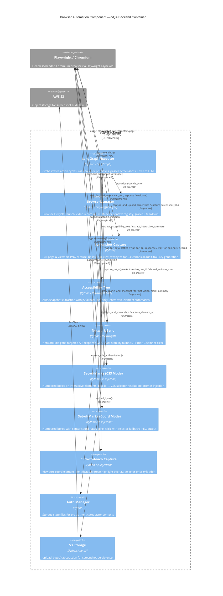

# C4 Component: Browser Automation

## Metadata

- **Component Name**: browser-automation
- **Run ID**: c4-2026-05-08-001
- **Generated**: 2026-05-08T00:00:00Z
- **Agent**: c4-component (Sonnet)
- **Container**: vQA Backend
- **Source Docs**: `memory-bank/c4/code/c4-code-backend-browser.md`
- **Source Directory**: `backend/browser` (8 Python modules)

---

## Overview

The Browser Automation component is the Playwright-based browser control layer for the vQA LangGraph engine. It provides all browser primitives needed for multimodal LLM reasoning: screenshot capture, ARIA accessibility tree extraction, network synchronization, Set-of-Marks (SoM) visual annotation, click-to-teach element identification, and full browser lifecycle management across multiple authenticated actors.

Every LLM action cycle is grounded in dual sensory input — a screenshot (visual) and an accessibility tree (semantic) — captured by this component. The component is exclusively in-process; all interactions occur via direct Python function calls from the executor node.

---

## Software Features

1. **Browser Lifecycle Management** — Launches and tears down Chromium (headed or headless) with video recording, manages per-run page/context objects, and maintains a run-keyed registry for multi-tenant concurrency.

2. **Dual-Mode Screenshot Capture** — Captures full-page PNG screenshots (base64 for LLM multimodal input) or viewport-only screenshots (for click-teach mode), and uploads to S3 with canonical audit-trail naming.

3. **ARIA Accessibility Tree Extraction** — Extracts the page ARIA tree as indented text using `page.aria_snapshot()` (Playwright 1.50+) with a JS DOM-walk fallback; prunes base64 URIs and SVG noise to stay under token budget.

4. **Network-Aware Timing Synchronization** — Waits for true page readiness using network-idle detection, targeted API response matching (glob patterns), and a DOM stability fallback for WebSocket-heavy SPAs; also clears PrimeNG loading spinners.

5. **Set-of-Marks Visual Grounding** — Two SoM modes: CSS-selector mode (numbered boxes → `box_id` → CSS selector resolution) and coordinate mode (numbered boxes with `{x, y}` center points → pixel click with selector fallback). Activated on healing tier ≥3, planner stuck ≥4 iterations, or explicit config.

6. **Click-to-Teach Element Capture** — On HITL pause events, identifies the DOM element under viewport-relative coordinates, injects a green highlight overlay, captures a viewport screenshot, and returns structured element metadata (selector, role, tag, text) for KB training data.

7. **Multi-Actor Context Switching** — Maintains an actor registry of pre-authenticated browser contexts; `switch_actor()` reuses cached contexts (~50ms) versus full re-authentication (~5–15s), enabling supervisor-worker multi-role test flows.

---

## In-Process Interface

Called directly by `backend/engine/executor.py` (and indirectly by `login_node`, `reporter_node`). No HTTP boundary.

| Caller | Function / Method | Module | Purpose |
|--------|-------------------|--------|---------|
| executor | `extract_accessibility_tree(page)` | `browser/accessibility.py:231` | Full ARIA tree for LLM reasoning prompt |
| executor | `extract_interactive_summary(page)` | `browser/accessibility.py:511` | Token-efficient interactive-elements-only summary |
| executor | `capture_and_upload_screenshot(page, run_id, step_index, action_type, s3_prefix, s3_bucket)` | `browser/screenshot.py:208` | Capture + S3 upload; returns `(base64, s3_url)` |
| executor | `capture_screenshot_b64(page)` | `browser/screenshot.py:62` | Base64 PNG for LLM multimodal input |
| executor | `capture_set_of_marks(page)` | `browser/set_of_marks.py:299` | CSS-mode SoM; returns `(screenshot_b64, {box_id: selector})` |
| executor | `resolve_box_id(action, som_map)` | `browser/set_of_marks.py:389` | Resolve LLM `box_id` to `{strategy, name}` locator |
| executor | `should_activate_som(state)` | `browser/set_of_marks.py:441` | Decides whether to invoke SoM mode this iteration |
| executor | `draw_marks_and_snapshot(page)` | `browser/vision_utils.py:280` | Coordinate-mode SoM; returns `(screenshot_b64, {mark_id: {x,y,selector}})` |
| executor | `wait_for_data_settled(page)` | `browser/network_sync.py:43` | Network idle + DOM stability gate |
| executor | `wait_for_api_response(page, url_pattern)` | `browser/network_sync.py:82` | Wait for specific API endpoint response |
| executor | `wait_for_spinners_cleared(page)` | `browser/network_sync.py:230` | Visual readiness gate (PrimeNG spinners) |
| executor / HITL | `highlight_and_screenshot(page, x_pct, y_pct)` | `browser/click_capture.py:316` | Click-to-teach: highlight + screenshot + element info |
| executor / HITL | `capture_element_at(page, x_pct, y_pct)` | `browser/click_capture.py:254` | DOM element identification at viewport coordinates |
| login_node | `BrowserManager.start()` | `browser/context.py:207` | Launch Chromium, create page + video context |
| login_node | `register_manager(run_id, manager)` | `browser/context.py:640` | Register manager in global run registry |
| login_node | `BrowserManager.switch_actor(role_key)` | `browser/context.py:332` | Switch to pre-authenticated actor context |
| reporter_node | `BrowserManager.close()` | `browser/context.py:466` | Teardown browser + finalize video |
| reporter_node | `unregister_manager(run_id)` | `browser/context.py:686` | Remove manager from global registry post-run |
| server shutdown | `get_all_managers()` | `browser/context.py:702` | Enumerate all active managers for graceful shutdown |

**Total interfaces: 18**

---

## External Dependencies

| Dependency | Type | Purpose |
|------------|------|---------|
| **playwright.async_api** | Third-party Python package | Page, Browser, BrowserContext, async_playwright; core browser control |
| **AWS S3** (via `backend.storage.s3.upload_bytes()`) | Internal abstraction over boto3 | Screenshot audit-trail upload |
| **backend.config** | Internal module | Headless/headed mode, viewport dimensions, S3 bucket/prefix settings |
| **backend.engine.auth_manager** | Internal module | `ensure_role_authenticated()` — provides storage state files for multi-actor context creation |

**Total external deps: 4**

---

## C4 Component Diagram

---

## Key Design Decisions

### Multimodal Grounding (Guiding Principle)
Every executor action cycle combines a screenshot (visual) and accessibility tree (semantic). Neither alone is sufficient: screenshots ground spatial reasoning while ARIA trees ground semantic role/name/state reasoning. Both are captured after each action and injected into the LLM prompt.

### Semantic Locators First (Guiding Principle)
The click-capture selector priority ladder follows this principle: `data-testid`/`data-vqa-id` test attributes first, then `aria-label`, then `#id`, then `tag.class` fingerprint, then positional `nth-child` as last resort. SoM CSS mode similarly returns CSS selectors (not coordinates) as the primary resolution path.

### Anti-Flake Network Strategy
`networkidle` (500ms no connections) is the primary timing gate, with a DOM stability fallback (3 consecutive identical `innerHTML.length` reads, 10 polls × 200ms) for WebSocket-heavy SPAs like vSuite. This avoids false-ready conditions from streaming connections.

### Set-of-Marks Activation Guard
SoM incurs overhead (JS injection, JPEG capture, larger prompts) and is intentionally bypassed on the happy path. It activates only when the engine is stuck: healing tier ≥3, planner iterating ≥4 times on the same acceptance-criterion step, explicit `use_som: true` config, or repeat count ≥3.

### Multi-Actor Context Registry
`BrowserManager._actor_registry` caches Playwright BrowserContext objects keyed by role. `switch_actor()` reuses cached contexts (~50ms) rather than re-creating from storage state (~5–15s), enabling fluid supervisor→worker role transitions within a single test run.

### Coordinate Drift Defense
Vision-mode SoM (`vision_utils.py`) stores both `{x, y}` viewport coordinates AND a CSS selector per mark. The executor tries the pixel-perfect click first; if the page has shifted (e.g., scroll or reflow), it falls back to the selector.

---

## Synthesis Hints

- **Container placement**: Co-located inside the vQA Backend container. No network boundary between this component and the LangGraph executor — all calls are synchronous in-process Python.
- **Data flow**: `executor.py` calls browser primitives in a tight see-act loop: `network_sync` → `screenshot` + `a11y` → LLM prompt → LLM response → action execution → repeat.
- **S3 boundary**: The only external I/O is screenshot upload to AWS S3 (fire-and-forget; base64 is also returned synchronously for immediate LLM use).
- **Playwright boundary**: Playwright manages a Chromium subprocess; the async API communicates over IPC. All `page.*` calls cross this boundary.
- **Healing integration**: `should_activate_som()` is the bridge between the engine's healing tier state (in `executor.py`/planner state) and the visual grounding strategy.
- **HITL integration**: `click_capture.py` is called exclusively in HITL pause flows; the structured element metadata it returns feeds directly into KB training data storage.
- **Video recording**: `BrowserManager` wraps each run in Playwright's built-in video recording (`recordVideo` context option); the `.webm` path is returned on `close()` and stored by the reporter node.
