# C4 Component: Knowledge Base

## Generated By
- **Agent**: c4-component (Sonnet)
- **Run ID**: c4-2026-05-08-001
- **Generated**: 2026-05-08T00:00:00Z
- **Component Name**: knowledge-base
- **Constituent Code Docs**: 2
  - `memory-bank/c4/code/c4-code-backend-kb.md` (backend/kb — 7 core modules)
  - `memory-bank/c4/code/c4-code-backend-memory.md` (backend/memory — 2 modules)

---

## Component Overview

- **Name**: Knowledge Base
- **Responsibility**: All knowledge retrieval and self-learning for the vQA AI engine. Provides TF-IDF RAG over local Markdown KB files, component/selector registry lookups, Playwright test code retrieval, persistent cross-run memory (SQLite), and an append-only skill library. Context blocks produced here are injected into planner prompts at both preflight (once per run) and per-step (reactive) phases.
- **Container**: vQA Backend (co-located, in-process)
- **Source Directories**: `backend/kb/`, `backend/memory/`
- **Language**: Python
- **Guiding Principles**:
  - HITL as Learning Signal — every human takeover writes to `knowledge/human_guidance.md` and is indexed by the local RAG engine; the agent improves over time
  - RAG-Based KB Retrieval — TF-IDF vectorization (scikit-learn) over `human_guidance.md`, `vSuite-actions.md`, component/selector registries, Playwright test files, and the skills library

---

## Software Features

| # | Feature | Module(s) | Description |
|---|---------|-----------|-------------|
| 1 | **Local KB RAG** | `loader.py` (`LocalKnowledgeBase`) | TF-IDF cosine similarity over Markdown KB files. Two-phase retrieval: exact-match shortcut for AUTO-LEARNED entries, then dynamic-threshold TF-IDF scoring. Hot-reloads on mtime change. |
| 2 | **Playwright Code RAG** | `playwright_rag.py` (`PlaywrightRAG`) | TF-IDF index over `.test.ts` / `.spec.ts` chunks from the vsuitePlatform repo. Surfaces working selectors and interaction patterns from real test code. |
| 3 | **Preflight Theme Scanning** | `preflight.py` (`build_global_context`) | Proactive pre-run scan of all AC steps together. Detects 9 broad themes and PrimeNG component gotchas, returning a compact `global_run_context` block (~3000 chars) injected at the top of every planner prompt. |
| 4 | **Component Registry** | `component_registry.py` (`ComponentRegistry`) | Keyword-triggered lookup of PrimeNG component interaction protocols, forbidden patterns, and Angular quirks from `component_registry.json`. |
| 5 | **Selector Registry** | `selector_registry.py` (`SelectorRegistry`) | Ground-truth confirmed Playwright selectors. Keyword-overlap scoring for lookup; HITL and verified selectors are persisted back to `selector_registry.json` at runtime. |
| 6 | **Persistent Memory** | `persistent.py` (`PersistentMemory`) | SQLite-backed cross-run memory. Records locator strategy outcomes (success/failure), aggregates pattern counts, and injects few-shot examples into planner prompts. Proposes KB updates for patterns proven 3+ times. |
| 7 | **Skill Library** | `skill_library.py` (`SkillLibrary`) | Append-only JSONL store of proven action sequences. TF-IDF retrieval surfaces reusable skills for the current AC step, enabling re-execution without re-exploration. Fingerprint-based deduplication. |
| 8 | **Unified Registry (Phase 5 — future)** | `unified_registry.py` (`UnifiedRegistry`) | Data model complete; consolidates component_registry + selector_registry + human_guidance into a single versioned `unified_components.json`. Generation script pending. |

---

## In-Process Interfaces

### Local KB RAG (`backend.kb.loader`)

| Interface | Signature | Description |
|-----------|-----------|-------------|
| `kb.query` | `(text: str, max_results: int = 1) → str` | TF-IDF retrieval with dynamic threshold; returns formatted KB context block |
| `kb.query_with_expansion` | `(text: str, max_results: int = 1) → str` | Synonym-expanded TF-IDF query for short or ambiguous step text |
| `kb.query_for_failure` | `(ac_step, error_message, last_action, max_results=2) → str` | Failure-enriched query combining step + error keywords + last action |
| `kb.reload_if_updated` | `() → bool` | Hot-reload KB index if any .md source file has changed |
| `kb.reload` | `() → None` | Force rebuild TF-IDF index |

### Playwright RAG (`backend.kb.playwright_rag`)

| Interface | Signature | Description |
|-----------|-----------|-------------|
| `playwright_rag.query` | `(ac_step_text, max_results=2) → str` | TF-IDF retrieval over Playwright test chunks (threshold 0.08) |
| `playwright_rag.reload` | `() → None` | Reload from disk |

### Preflight (`backend.kb.preflight`)

| Interface | Signature | Description |
|-----------|-----------|-------------|
| `build_global_context` | `async (steps, ticket_id="") → str` | Scan all AC steps; return global_run_context prompt block (~3000 chars). Runs in thread-pool executor. |

### Component Registry (`backend.kb.component_registry`)

| Interface | Signature | Description |
|-----------|-----------|-------------|
| `component_registry.detect_components` | `(ac_step_text: str) → list[str]` | Keyword match; returns list of detected component keys |
| `component_registry.get_component_rules` | `(component_keys: list[str]) → str` | Build formatted prompt block with interaction steps, quirks, forbidden patterns |

### Selector Registry (`backend.kb.selector_registry`)

| Interface | Signature | Description |
|-----------|-----------|-------------|
| `selector_registry.query` | `(ac_step_text, max_results=3) → str` | Keyword-overlap lookup; returns formatted selector hints |
| `selector_registry.record_hitl_selector` | `(description, selector, strategy, context, role, name) → str` | Persist HITL-confirmed selector; returns registry key |
| `selector_registry.record_verified_selector` | `(ac_step_text, strategy, name, selector, role, context) → str` | Persist verified post-success selector |

### Persistent Memory (`backend.memory.persistent`)

| Interface | Signature | Description |
|-----------|-----------|-------------|
| `persistent_memory.record` | `(situation, strategy_tried, worked, strategy_fix, ac_step, ticket_id)` | Record locator strategy outcome |
| `persistent_memory.get_few_shot_examples` | `(current_step, max_examples=3) → str` | Retrieve relevant past patterns as formatted few-shot injection block |
| `persistent_memory.propose_kb_updates` | `(min_success_count=3)` | Identify patterns proven N+ times for manual KB promotion |
| `persistent_memory.close` | `() → None` | Close SQLite connection on shutdown |

### Skill Library (`backend.memory.skill_library`)

| Interface | Signature | Description |
|-----------|-----------|-------------|
| `skill_library.record_skill` | `(ac_step_text, actions, jira_key, role)` | Persist proven action sequence; deduplicates on fingerprint |
| `skill_library.query` | `(ac_step_text) → str` | TF-IDF retrieval of relevant skills; returns formatted injection block |
| `skill_library.reload` | `() → None` | Reload from JSONL and mark index dirty |

---

## External Dependencies

| Dependency | Type | Used By | Purpose |
|------------|------|---------|---------|
| `scikit-learn` (TfidfVectorizer, cosine_similarity) | PyPI | `loader.py`, `playwright_rag.py`, `skill_library.py` | TF-IDF vectorization and cosine similarity scoring for all RAG systems |
| `numpy` | PyPI | `loader.py`, `playwright_rag.py`, `skill_library.py` | Array operations for similarity scoring |
| `sqlite3` (stdlib) | Python stdlib | `persistent.py` | Cross-run pattern storage (WAL mode, `memory/learned_patterns.db`) |
| `knowledge/component_registry.json` | Local file | `component_registry.py`, `preflight.py` | PrimeNG component interaction protocols, forbidden patterns, Angular quirks |
| `knowledge/selector_registry.json` | Local file | `selector_registry.py` | 3,969 lines of confirmed Playwright selectors |
| `knowledge/human_guidance.md` | Local file | `loader.py` | 683 lines of human-written interaction rules (HITL entries, threshold 0.05) |
| `knowledge/vSuite-actions.md` | Local file | `loader.py` | Domain workflow descriptions |
| `knowledge/knowledge_base_manuals.md` | Local file | `loader.py` | 416KB large KB manual (chunked into ~100 searchable docs) |
| `../vsuitePlatform/playwright/` | External repo dir | `playwright_rag.py` | Playwright test files (`.test.ts`, `.spec.ts`) for code-level RAG |
| `memory/learned_patterns.db` | Local file | `persistent.py` | SQLite database for cross-run locator pattern memory |
| `memory/skills.jsonl` | Local file | `skill_library.py` | Append-only proven action sequence store |

---

## C4 Component Diagram

```mermaid
C4Component
    title Knowledge Base Component — vQA Backend

    Container_Boundary(vqa_backend, "vQA Backend") {

        Component(local_kb_rag, "Local KB RAG", "Python / scikit-learn TF-IDF", "Two-phase TF-IDF retrieval over Markdown KB files. Dynamic thresholds, synonym expansion, failure-enriched queries, hot-reload on mtime.")

        Component(playwright_rag, "Playwright Code RAG", "Python / scikit-learn TF-IDF", "TF-IDF index over .test.ts/.spec.ts chunks from vsuitePlatform. Surfaces real working selectors and interaction patterns.")

        Component(preflight, "Preflight Scanner", "Python / async", "Pre-run scan of all AC steps. Detects 9 themes + PrimeNG component gotchas. Returns global_run_context injected at start of every planner prompt.")

        Component(component_registry, "Component Registry", "Python / JSON", "Keyword-triggered lookup of PrimeNG component interaction protocols, forbidden patterns, and Angular quirks.")

        Component(selector_registry, "Selector Registry", "Python / JSON + threading.Lock", "Ground-truth confirmed Playwright selectors. Read lookup + HITL/verified write-back.")

        Component(persistent_memory, "Persistent Memory", "Python / SQLite WAL", "Cross-run locator strategy outcomes. Pattern aggregation, few-shot example injection, KB update proposals.")

        Component(skill_library, "Skill Library", "Python / JSONL + TF-IDF", "Append-only proven action sequences. TF-IDF retrieval for step reuse without re-exploration.")

        Component(unified_registry, "Unified Registry (Phase 5)", "Python / JSON (future)", "Future consolidation of component + selector + human_guidance into single versioned registry.")

        Component(planner, "Planner", "Python", "AI planning engine — consumes all KB context blocks")
        Component(evaluator, "Evaluator", "Python", "Marks steps SATISFIED — triggers skill recording and verified selector writes")
        Component(human_takeover, "Human Takeover", "Python", "HITL intervention — writes to human_guidance.md and selector registry")
        Component(executor, "Executor", "Python", "Provides ExecutionStep dicts for skill recording")
    }

    SystemDb(sqlite_db, "learned_patterns.db", "SQLite WAL — cross-run pattern store")
    SystemDb(skills_jsonl, "skills.jsonl", "Append-only proven action sequences")
    SystemDb(kb_files, "knowledge/ Files", "component_registry.json, selector_registry.json, human_guidance.md, vSuite-actions.md, knowledge_base_manuals.md")
    System_Ext(vsuite_playwright, "vsuitePlatform/playwright", "External repo — .test.ts / .spec.ts test files")

    Rel(planner, local_kb_rag, "query / query_with_expansion / query_for_failure", "in-process")
    Rel(planner, playwright_rag, "query", "in-process")
    Rel(planner, preflight, "build_global_context", "in-process async")
    Rel(planner, component_registry, "detect_components / get_component_rules", "in-process")
    Rel(planner, selector_registry, "query", "in-process")
    Rel(planner, persistent_memory, "get_few_shot_examples", "in-process")
    Rel(planner, skill_library, "query", "in-process")

    Rel(evaluator, skill_library, "record_skill", "in-process")
    Rel(evaluator, selector_registry, "record_verified_selector", "in-process")
    Rel(evaluator, persistent_memory, "record", "in-process")

    Rel(human_takeover, selector_registry, "record_hitl_selector", "in-process")

    Rel(executor, persistent_memory, "record", "in-process")

    Rel(preflight, component_registry, "detect_components", "in-process")

    Rel(local_kb_rag, kb_files, "reads / hot-reloads", "filesystem")
    Rel(component_registry, kb_files, "reads component_registry.json", "filesystem")
    Rel(selector_registry, kb_files, "reads/writes selector_registry.json", "filesystem")
    Rel(playwright_rag, vsuite_playwright, "reads .test.ts chunks", "filesystem")
    Rel(persistent_memory, sqlite_db, "reads/writes patterns + counts", "SQLite WAL")
    Rel(skill_library, skills_jsonl, "append/read skills", "filesystem JSONL")
```



---

## Context Injection Flow (Phase-Based)

```
Test Run Start
    │
    ▼
[PREFLIGHT] build_global_context(all_ac_steps)
    ├── _detect_themes → load KB articles for 9 themes
    ├── _extract_gotchas → component registry forbidden patterns + Angular quirks
    └── → global_run_context (~3000 chars) injected into EVERY planner prompt
    │
    ▼
[PER-STEP] For each AC step:
    ├── component_registry.detect_components + get_component_rules
    ├── selector_registry.query
    ├── kb.query_with_expansion (or kb.query_for_failure on retry)
    ├── playwright_rag.query
    ├── persistent_memory.get_few_shot_examples
    └── skill_library.query
    │
    ▼
Planner Prompt = global_run_context + per-step context blocks
    │
    ▼
[POST-STEP — on SATISFIED]:
    ├── skill_library.record_skill
    ├── selector_registry.record_verified_selector
    └── persistent_memory.record(worked=True)
    │
[POST-STEP — on HITL takeover]:
    ├── human_guidance.md updated (HITL writes)
    ├── selector_registry.record_hitl_selector
    ├── persistent_memory.record(worked=False / fix recorded)
    └── kb.reload_if_updated → hot-reload for next step
```

---

## Memory Tier Architecture

| Tier | Component | Storage | Lifetime | Purpose |
|------|-----------|---------|---------|---------|
| Tier 1 | VQAState.long_term_memory | In-process dict | Single run | Short-term working context |
| Tier 2 | PersistentMemory + SkillLibrary | SQLite + JSONL | Cross-run | Proven patterns and reusable skills |
| Tier 3 | KB Files (human_guidance.md, component_registry.json, etc.) | Filesystem | Permanent | Ground-truth rules (promote via `make kb-refresh`) |

---

## Key Design Decisions

1. **TF-IDF over LLM embeddings** — Chosen for speed, determinism, and no external API dependency. Bigram (1,2-gram) vectorization with dynamic thresholds accounts for query specificity.

2. **HITL entries use 0.05 threshold** — Human-written guidance phrases vary in wording; lower threshold ensures HITL knowledge is always surfaced even with paraphrasing.

3. **Phase-based injection** — Preflight runs once (themes and gotchas), per-step runs reactively. This avoids re-scanning all steps on every planner call while still providing broad context.

4. **Hot-reload on mtime** — `LocalKnowledgeBase.reload_if_updated()` is called on every query; detects HITL writes to human_guidance.md immediately, rebuilding index only when files change.

5. **Append-only JSONL for skills** — No lock contention for concurrent runs; natural write ordering. Deduplication via fingerprint (action/strategy/name triples) prevents bloat.

6. **Singleton pattern for all registries** — All RAG systems are module-level singletons; state (TF-IDF index, JSON data, SQLite connection) is loaded once and reused across all requests.

---

## Known Limitations & Roadmap

| Item | Status | Notes |
|------|--------|-------|
| Unified Registry (Phase 5) | Pending | Data model complete; `unified_components.json` generation script not yet built |
| Selector registry size | Active concern | 3,969 lines; stale entries need periodic cleanup |
| TF-IDF paraphrase gaps | Known | May miss paraphrased articles; LLM embeddings considered for future phases |
| Test coverage | Partial | `test_matcher.py` (507 lines) + `test_selector_completeness.py` (192 lines) exist but edge case coverage incomplete |

---

## Synthesis Hints

- **Co-located** with vQA Backend container — all interfaces are in-process Python calls; no network hops
- **AWS Bedrock KB** referenced in guiding principles but not yet observed in constituent code docs — retrieval is currently fully local (TF-IDF over filesystem). Bedrock KB integration is a candidate future upgrade path.
- **HITL feedback loop closes here** — human_takeover.py writes to knowledge files that this component indexes; the agent's knowledge grows without redeployment
- This component is the **single source of retrieved context** for all planner prompts — no other component queries external knowledge stores

---

C4-COMPONENT STATUS: COMPLETE
Component: knowledge-base
Constituent code docs: 2
Interfaces: 18
External deps: 11
Output: memory-bank/c4/components/c4-component-knowledge-base.md
