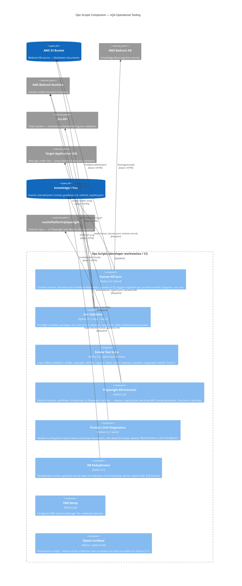

# C4 Component: Ops Scripts

## Generated By
- **Agent**: c4-component (Sonnet)
- **Run ID**: c4-2026-05-08-001
- **Generated**: 2026-05-08T00:00:00Z
- **Component Name**: ops-scripts
- **Constituent Code Docs**: 2
  - `memory-bank/c4/code/c4-code-scripts.md` (scripts/ — 6 files: 5 Python, 1 shell)
  - `memory-bank/c4/code/c4-code-root.md` (project root — conftest.py, dedup_kb.py)

---

## Component Overview

- **Name**: Ops Scripts
- **Responsibility**: Standalone operational and maintenance tooling for the vQA project. Covers the full operational lifecycle outside production runtime: syncing human-learned selectors to AWS Bedrock KB, validating environment configuration, running pre-flight smoke tests across 5 tiers, extracting knowledge assets from Playwright test branches, diagnosing LLM context-window limits, deduplicating the human guidance KB, and configuring AWS SSM credentials.
- **Container**: NOT a deployed container — run on-demand from a developer workstation or CI pipeline
- **Source Directories**: `scripts/`, `.` (project root: `dedup_kb.py`, `conftest.py`)
- **Language**: Python 3.10+, Shell
- **Deployment**: Operational tooling — not a container; run from developer workstation or CI
- **Guiding Principles**:
  - Config in Environment — all scripts read config from environment variables (or `.env` via python-dotenv); no hardcoded credentials, bucket names, or endpoint URLs
  - CLI-first design — every script has a CLI entry point; `--dry-run` supported where state is mutated

---

## Software Features

| # | Feature | Script(s) | Description |
|---|---------|-----------|-------------|
| 1 | **Human KB Sync to Bedrock** | `sync_human_kb.py` | Reads human-captured selectors from `knowledge/human_learned.jsonl`, converts to Bedrock-ingestible Markdown, uploads to S3, triggers a Bedrock KB ingestion job, and archives the processed records. Supports `--dry-run` and `--no-archive` flags. |
| 2 | **Environment Pre-flight Validation** | `validate_env.py` | Checks all required Python packages, environment variables (AWS, Jira), and live service connectivity (Jira API, S3 bucket, Bedrock model, target app URL). Outputs ANSI-colored summary table with pass/warn/fail per check. |
| 3 | **Smoke Test Suite** | `smoke_test.py` | Runs a 5-tier offline validation sweep (no live browser/SSM): verifier evidence paths, evaluator fast-path, KB file existence, KB loader retrieval, selector registry, ReAct planner parsing, SQLite memory, step classifier, LangGraph compilation, FastAPI app import. Exits 0 on full pass, 1 on any failure. |
| 4 | **Playwright KB Extractor** | `extract_playwright_kb.py` | One-time or periodic extraction of locator patterns, workflow steps, and timing constants from a Playwright test branch (`.ts` files) into `selector_registry.json`, workflow KB Markdown, and `angular_timing_contracts.md`. Preserves hand-edited entries on merge. |
| 5 | **LLM Prompt-Limit Diagnostics** | `test_prompt_limits.py` | Needle-in-a-Haystack diagnostic: injects random tokens at prompt START and END, calls Bedrock Claude, detects TRUNCATION vs. LOST-IN-MIDDLE failure modes. Used to validate context window behavior before production runs. |
| 6 | **Knowledge Base Deduplication** | `dedup_kb.py` | Parses `knowledge/human_guidance.md`, groups workflow entries by normalized topic (first 60 chars), retains newest per group (timestamp + char-count tiebreaker), atomically rewrites with `.bak` backup. CLI: `--apply` to write, dry-run by default. |

---

## Interfaces

### Inbound

None — these are standalone CLI scripts. No network interface, no API surface. Invoked directly by a developer or CI job via command line.

### Outbound

| Target | Protocol | Script(s) | Purpose |
|--------|----------|-----------|---------|
| **AWS S3** | boto3 (`PutObject`) | `sync_human_kb.py`, `validate_env.py` | Upload Bedrock-ingestible Markdown (`sync_human_kb.py`); verify bucket access (`validate_env.py`) |
| **AWS Bedrock Agent** | boto3 (`StartIngestionJob`) | `sync_human_kb.py` | Trigger KB re-indexing after S3 upload |
| **AWS Bedrock Runtime** | boto3 (`InvokeModel`) | `test_prompt_limits.py` | Call Claude to validate prompt context window behavior |
| **Jira API** | httpx (REST) | `validate_env.py` | Verify Jira credentials and connectivity during environment pre-flight |
| **Target App URL** | httpx (HTTP GET) | `validate_env.py` | Ping target application during environment pre-flight |
| **Local filesystem** | Python stdlib | all scripts | Read/write `knowledge/`, `memory/`, `scripts/` files; backup and archive operations |

---

## External Dependencies

| Dependency | Type | Used By | Purpose |
|------------|------|---------|---------|
| `boto3` | PyPI | `sync_human_kb.py`, `validate_env.py`, `test_prompt_limits.py` | AWS SDK: S3 upload, Bedrock ingestion jobs, Bedrock model invocation |
| `httpx` | PyPI | `validate_env.py` | HTTP connectivity checks for Jira API and target app URL |
| `python-dotenv` | PyPI | all Python scripts | Load `.env` file into environment at startup; graceful fallback to shell env |
| `numpy` | PyPI | `conftest.py` | Pre-imported to prevent sys.path corruption during pytest collection on Python 3.13 |
| `scikit-learn` (`TfidfVectorizer`) | PyPI | `conftest.py` | Pre-imported alongside numpy for same pytest collection stability fix |
| `knowledge/human_learned.jsonl` | Local file | `sync_human_kb.py` | Staging file for human takeover selector records |
| `knowledge/human_guidance.md` | Local file | `dedup_kb.py`, `smoke_test.py` | Human guidance KB — read for dedup, existence-checked in smoke test |
| `knowledge/selector_registry.json` | Local file | `extract_playwright_kb.py`, `smoke_test.py` | Confirmed Playwright selectors — merged on extraction, loaded in smoke test |
| `backend.*` (in-process imports) | Internal | `smoke_test.py`, `test_prompt_limits.py` | Engine components under test (verifier, evaluator, planner, graph, state, step_classifier, FastAPI app, LocalKnowledgeBase, SelectorRegistry, PersistentMemory) |
| `backend.config.settings` | Internal | `validate_env.py`, `test_prompt_limits.py` | Centralized settings object (reads from env) |

---

## C4 Component Diagram

---

## Script Inventory

| Script | Entry Point | Key Flags | Mutates State? |
|--------|-------------|-----------|----------------|
| `scripts/sync_human_kb.py` | `main()` | `--staging`, `--s3-bucket`, `--kb-id`, `--data-source-id`, `--dry-run`, `--no-archive` | Yes — S3 upload, Bedrock ingestion, local archive |
| `scripts/smoke_test.py` | module `__main__` | (none) | No — read-only validation |
| `scripts/validate_env.py` | `main()` | (none) | No — read-only checks |
| `scripts/extract_playwright_kb.py` | `main(args)` | `--playwright-root`, `--output-dir`, `--skip-existing`, `--append-timing` | Yes — writes/merges knowledge files |
| `scripts/test_prompt_limits.py` | `main()` | `--ticket`, `--step`, `--verbose` | No — diagnostic only |
| `scripts/setup_ssm.sh` | shell | (varies) | Yes — AWS SSM configuration |
| `dedup_kb.py` (root) | `main()` | `--apply` (default: dry-run) | Conditional — rewrites on `--apply` |
| `conftest.py` (root) | pytest hook | (N/A) | No — import stabilization only |

---

## Key Design Decisions

1. **Config in Environment throughout** — All scripts use environment variables (AWS credentials, bucket names, KB IDs, Jira domain/token, target URL). `python-dotenv` loads `.env` as a convenience with graceful fallback; no credentials are ever hardcoded.

2. **`--dry-run` as a first-class flag** — Scripts that mutate remote state (`sync_human_kb.py`) or local files (`extract_playwright_kb.py`) support `--dry-run`/preview mode, making them safe to test in CI or staging without side effects.

3. **Offline-first smoke tests** — `smoke_test.py` is deliberately designed to run without a live browser, SSM session, or network connection. This makes it usable in any environment as a rapid pre-flight check after code changes.

4. **Preserve hand-edited files on merge** — `extract_playwright_kb.py` merges into existing `selector_registry.json` rather than overwriting, ensuring manually curated entries survive KB refresh cycles.

5. **Atomic rewrite with backup** — `dedup_kb.py` creates a `.bak` copy before rewriting `human_guidance.md`, ensuring safe rollback if deduplication produces unexpected results.

---

## Known Limitations & Roadmap

| Item | Status | Notes |
|------|--------|-------|
| `extract_playwright_kb.py` is one-time | Active use | Designed for periodic re-runs; `--skip-existing` flag controls merge behavior |
| `setup_ssm.sh` not fully parsed | Low priority | Shell script; purpose is SSM credential injection; details not exposed in code docs |
| No orchestration layer | By design | Scripts are intentionally standalone; CI pipeline (if any) provides sequencing |
| Bedrock ingestion job polling | Missing | `sync_human_kb.py` triggers ingestion but does not wait/poll for completion |

---

## Synthesis Hints

- **Not a container** — these scripts live outside all container boundaries in C4 diagrams; they are the operational control plane, not the application runtime
- **Feeds the Knowledge Base component** — `sync_human_kb.py` closes the HITL feedback loop at the infrastructure level (S3 → Bedrock), complementing the in-process KB writes done by `backend/engine/human_takeover.py`
- **Smoke test covers the entire backend stack** — `smoke_test.py` is the fastest way to confirm that a backend code change has not broken core contracts; it spans KB, engine, memory, graph, and API layers in a single offline run
- **`dedup_kb.py` is a safety valve** — as human takeover sessions accumulate, `human_guidance.md` grows; this utility keeps the file manageable without losing any unique knowledge

---

C4-COMPONENT STATUS: COMPLETE
Component: ops-scripts
Constituent code docs: 2
Interfaces: 6 outbound (0 inbound)
External deps: 10
Output: memory-bank/c4/components/c4-component-ops-scripts.md
