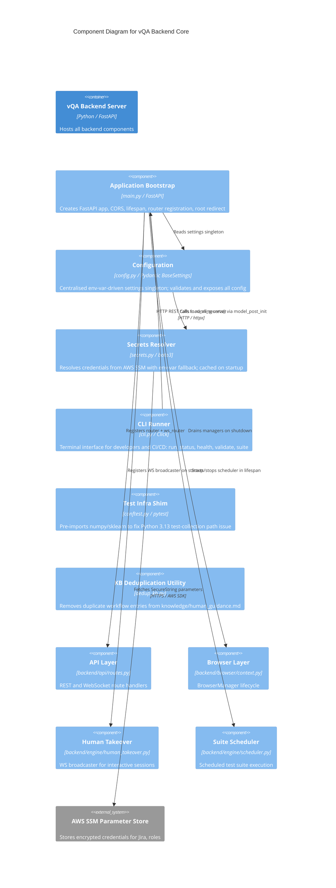

# C4 Component Level: vQA Backend Core

## Generated By
- **Agent**: c4-component (Sonnet)
- **Run ID**: c4-2026-05-08-001
- **Generated**: 2026-05-08T00:00:00Z
- **Constituent Code Docs**: 2 files

## Overview
- **Name**: vQA Backend Core
- **Description**: FastAPI application bootstrap, Pydantic settings, AWS SSM secrets resolution, and CLI runner for vQA
- **Type**: Application
- **Technology**: Python 3.12 / FastAPI / Pydantic / Click / boto3

## Purpose
The vQA Backend Core component is the entry point and operational spine of the backend server. It bootstraps the FastAPI application (including CORS, lifecycle events, and router registration), resolves all configuration from environment variables and AWS SSM Parameter Store at startup, manages browser session shutdown and suite scheduler lifecycle, and exposes a terminal-based CLI (`vqa`) for developers and CI/CD pipelines to trigger test runs, query status, manage suites, and validate the environment. The project root also contains a pytest conftest shim and a standalone knowledge-base deduplication utility that are outside the runtime path but are part of the overall source tree.

## Software Features

- **Application Bootstrap**: `main.py` creates the FastAPI app, registers CORS middleware for the React frontend, wires REST and WebSocket routers, and provides a root redirect (`GET /`) to Swagger UI (`/docs`).
- **Lifespan Management**: On startup, configures structured logging, registers the WebSocket broadcaster for human-takeover events, and starts the suite scheduler. On shutdown, drains all active BrowserManager instances (with per-manager timeouts) and stops the scheduler — preventing zombie Chromium processes.
- **Centralised Configuration**: `config.py` provides a Pydantic `Settings` singleton covering Jira, AWS, LLM/Bedrock, GitHub, webhooks, API auth, state store, S3 storage, role credentials, and application behaviour. All values come from environment variables or a `.env` file; computed properties construct derived URLs and S3 prefixes.
- **Secrets Resolution**: `secrets.py` resolves sensitive credentials (Jira token, Jira domain, role passwords) from AWS SSM Parameter Store at startup, with automatic fallback to environment variables and a `SKIP_SSM=1` bypass for local development. Values are module-level cached to avoid repeated SSM round-trips.
- **Command-Line Interface**: `cli.py` provides a Click CLI group (`vqa`) with subcommands for `run`, `status`, `health`, `validate`, and `suite` (list / create / run / delete). It communicates exclusively via the backend REST API (httpx) and implements configurable polling loops and colour-coded ANSI output.
- **Test Infrastructure Shim**: `conftest.py` pre-imports numpy and `sklearn.feature_extraction.text` at test-collection time to prevent sys.path corruption on Python 3.13.
- **Knowledge-Base Deduplication Utility**: `dedup_kb.py` parses `knowledge/human_guidance.md`, groups workflow entries by normalised topic, retains the newest entry per group (with character-count tiebreaker), and atomically rewrites the file with a `.bak` backup.

## Code Elements
- [`code/c4-code-backend.md`](../code/c4-code-backend.md) — Backend root layer: `main.py` (FastAPI app + lifespan), `config.py` (Pydantic Settings singleton), `secrets.py` (SSM secret resolution), `cli.py` (Click CLI), `__init__.py` (package docstring)
- [`code/c4-code-root.md`](../code/c4-code-root.md) — Project root scripts: `conftest.py` (pytest import shim) and `dedup_kb.py` (knowledge-base deduplication utility)

## Interfaces

### REST API (server-side)
- **Protocol**: HTTP/1.1 (FastAPI, Uvicorn)
- **Operations**: `GET /` (redirect to docs), all routes delegated to `backend/api/routes.py` (`router` and `ws_router`)
- **Contract**: OpenAPI spec auto-generated; accessible at `/docs`

### WebSocket API (server-side)
- **Protocol**: WebSocket (via FastAPI `ws_router`)
- **Operations**: Real-time log streaming and human-takeover event broadcast
- **Contract**: WS broadcaster registered at startup via `set_ws_broadcaster` in `backend.engine.human_takeover`

### CLI (outbound)
- **Protocol**: HTTP (httpx) to `http://localhost:8000` (configurable via `--url`)
- **Operations**: `POST /execute`, `GET /status/{run_id}`, `GET /health`, `GET /health/ready`, `GET /tickets?limit=1`, `GET /suites`, `POST /suites`, `POST /suites/{id}/run`, `GET /batch-status/{batch_id}`, `DELETE /suites/{suite_id}`
- **Contract**: JSON request/response; CLI is a thin client — no direct DB or engine access

### Settings Singleton (internal)
- **Protocol**: Python import (`from backend.config import settings`)
- **Operations**: Read-only access to the `Settings` object across the entire backend
- **Contract**: Pydantic-validated at startup; any missing required field raises `ValidationError` and halts startup

## Dependencies

### Components Used
- **vQA API Layer** (`backend/api/routes.py`) — Provides `router` (REST) and `ws_router` (WebSocket) registered by `main.py`; also provides `_broadcast_human_takeover` for WS broadcaster setup
- **vQA Browser Layer** (`backend/browser/context.py`) — `get_all_managers()` called during shutdown to drain active BrowserManager instances
- **vQA Engine – Human Takeover** (`backend/engine/human_takeover.py`) — `set_ws_broadcaster()` called at startup to connect WebSocket broadcast to the human-takeover node
- **vQA Engine – Scheduler** (`backend/engine/scheduler.py`) — `start_scheduler()` and `stop_scheduler()` called in the FastAPI lifespan handler
- **vQA Knowledge Base** (`knowledge/human_guidance.md`) — Read and optionally rewritten by the `dedup_kb.py` utility (development-time only)

### External Systems
- **AWS SSM Parameter Store** — Source of truth for Jira credentials, Jira domain, and role passwords at startup (via boto3/botocore); bypassed with `SKIP_SSM=1`
- **FastAPI / Uvicorn** — HTTP and WebSocket server framework; app instance created in `main.py`
- **Pydantic / pydantic-settings** — Configuration validation and environment-variable binding via `BaseSettings`
- **Click** — CLI framework for the `vqa` terminal interface
- **httpx** — HTTP client used by the CLI to call the backend REST API
- **boto3 / botocore** — AWS SDK for SSM Parameter Store access and error handling

## Component Diagram

## Notes for Higher-Level Synthesis
- **Likely deployment**: Single deployable backend container — `main.py` is the Uvicorn entry point; all sub-components (`config`, `secrets`, `cli`) live in the same Python process and container image.
- **Cross-container traffic**: `secrets.py` calls AWS SSM Parameter Store over HTTPS at startup — this is the only cross-boundary network call initiated by this component during the server boot sequence. The CLI (`cli.py`) communicates back to the same backend container over HTTP (localhost), so it is typically run in the same host environment.
- **12-Factor compliance**: All configuration flows through `Settings` (env vars / `.env`); no hardcoded URLs or credentials; `SKIP_SSM=1` enables dev/prod parity without AWS access.
- **Startup fast-fail**: Pydantic validation and SSM resolution happen at process start; misconfiguration surfaces immediately before any request is handled.
- **Observability**: Log level set from `LOG_LEVEL` env var; third-party loggers explicitly quieted; secrets module logs SSM fetch status and missing-credential warnings.
