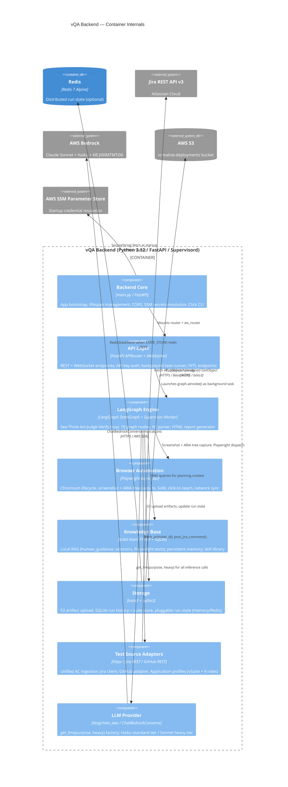

# C4 Container: vQA Backend

## Generated By

- **Agent**: c4-container (Sonnet, per-container mode)
- **Run ID**: c4-2026-05-08-001
- **Generated**: 2026-05-08T00:00:00Z

## Overview

| Attribute | Value |
|-----------|-------|
| **Name** | vQA Backend |
| **Class** | Compute |
| **Type** | API + Worker (autonomous test execution engine) |
| **Technology** | Python 3.12 / FastAPI 0.115+ / LangGraph 0.2+ / Playwright 1.49+ / Supervisord |
| **Deployment** | Docker Compose service (`vqa-backend`) built from `docker/Dockerfile` |
| **IaC Resource** | `service / vqa-backend` — `docker/docker-compose.yml:25` |
| **Inferred?** | No — explicitly declared in docker-compose.yml |
| **Image Trace** | Traced to `docker/Dockerfile` (multi-stage build: `python:3.12-slim` → app stage) |
| **Ports** | 8000 (FastAPI API + Swagger UI); 6080 (noVNC WebSocket proxy, interactive mode only) |
| **Memory Limit** | 4GB (interactive); 3GB (CI variant) |
| **CPU Limit** | 2.0 CPUs (interactive); 1.5 CPUs (CI variant) |
| **Process Manager** | Supervisord (interactive): manages Xvfb + x11vnc + websockify + uvicorn. CI variant: uvicorn directly |

## Purpose

The vQA Backend is the autonomous QA execution engine. It accepts a Jira ticket ID and a user role, fetches the ticket's acceptance criteria, compiles them into a structured test plan, and drives a headed or headless Chromium browser through each AC step using a See-Think-Act-Judge-Verify LangGraph state machine. The backend embeds everything needed for a complete test run in a single deployable image: the FastAPI API and WebSocket server, the LangGraph orchestration engine (with Supervisor-Worker specialization), Playwright browser automation (with video recording and ARIA tree extraction), TF-IDF Knowledge Base RAG (local Markdown files), S3 artifact upload, Jira client, and persistent SQLite memory.

In interactive mode the container also starts Xvfb, x11vnc, and noVNC via supervisord, enabling live browser streaming at port 6080 to the React dashboard's embedded noVNC iframe. In headless/CI mode it skips the virtual display stack entirely and runs uvicorn directly.

## Components Deployed Here

All eight backend components live inside this single container image (same Python process):

| Component | Source Directory | Role |
|-----------|-----------------|------|
| [vQA Backend Core](../components/c4-component-vqa-backend-core.md) | `backend/` (root: main.py, config.py, secrets.py, cli.py) | FastAPI bootstrap, Pydantic settings, SSM secrets, Click CLI |
| [API Layer](../components/c4-component-api-layer.md) | `backend/api/` | REST + WebSocket endpoints, API key auth, HITL control surface |
| [LangGraph Engine](../components/c4-component-langgraph-engine.md) | `backend/engine/`, `backend/engine/tools/`, `backend/engine/workers/` | Core QA state machine: AC parse, See-Think-Act loop, HITL, report |
| [Browser Automation](../components/c4-component-browser-automation.md) | `backend/browser/` | Playwright lifecycle, screenshot capture, ARIA tree, SoM, click-to-teach |
| [Knowledge Base](../components/c4-component-knowledge-base.md) | `backend/kb/`, `backend/memory/` | TF-IDF RAG over local KB files, selector registry, persistent SQLite memory, skill library |
| [Storage](../components/c4-component-storage.md) | `backend/storage/`, `backend/store/` | S3 artifact bridge, SQLite run history, test suite CRUD, pluggable run state (memory or Redis) |
| [Test Source Adapters](../components/c4-component-test-source-adapters.md) | `backend/adapters/`, `backend/jira/`, `backend/profiles/` | Unified AC ingestion (Jira, GitHub, raw text), auto-detection, application profiles, RBAC role definitions |
| [LLM Provider](../components/c4-component-llm-provider.md) | `backend/llm/` | Provider-agnostic factory: `get_llm(purpose, heavy)` → ChatBedrockConverse; tiered model routing (Haiku standard / Sonnet heavy) |

## Interfaces

### REST API (Inbound)

All endpoints on port 8000. Protected by `X-VQA-API-Key` header (except health probes).

| Group | Key Endpoints | Auth |
|-------|--------------|------|
| Test Execution | `POST /execute`, `POST /execute-batch` | API Key |
| Run Control | `GET /status/{run_id}`, `POST /run/{run_id}/cancel`, `GET /batch-status/{batch_id}` | API Key |
| HITL Control | `POST /runs/{run_id}/interact`, `POST /runs/{run_id}/teach/capture-click`, `POST /runs/{run_id}/teach` | API Key |
| Analytics & History | `GET /runs/history`, `GET /runs/analytics` | API Key |
| Test Suites | `POST|GET|PUT|DELETE /suites`, `POST /suites/{suite_id}/run` | API Key |
| Tickets & Reports | `GET /tickets`, `GET /reports`, `GET /preview-steps`, `GET /ticket/{id}/credentials` | API Key |
| Knowledge Base | `GET /kb-proposals` | API Key |
| Health | `GET /health` (liveness), `GET /health/ready` (readiness — checks Jira + S3 + Bedrock) | None |

Full schema: OpenAPI spec auto-generated at `/docs` when the backend is running.

### WebSocket API (Inbound)

| Path | Auth | Events Streamed |
|------|------|-----------------|
| `WS /ws/{run_id}` | None | `step`, `thinking`, `screenshot`, `ac_progress`, `copilot_ready`, `triage`, `completed`, `failed` |

Behavior: On connect, if the run has already completed, final state is immediately sent. Otherwise the connection is held open until the run terminates or client disconnects.

### noVNC Stream (Inbound, Interactive Mode Only)

| Port | Protocol | Purpose |
|------|---------|---------|
| 6080 | WebSocket (noVNC/websockify) | Live browser stream from x11vnc → websockify → browser client; embedded as iframe in React dashboard |

### Outbound Dependencies

| System | Protocol | Notes |
|--------|---------|-------|
| Redis | TCP / Redis protocol (port 6379) | Optional — only when `STATE_STORE=redis`; default is in-memory |
| Jira REST API v3 | HTTPS / Basic Auth | Ticket fetch, board listing, comment posting |
| AWS Bedrock (Claude Sonnet) | HTTPS / AWS SDK | Multimodal planning (heavy=True tier) |
| AWS Bedrock (Claude Haiku) | HTTPS / AWS SDK | LLM verification fallback + AC parsing (standard tier) |
| AWS Bedrock Knowledge Base | HTTPS / AWS SDK (boto3) | RetrieveAndGenerate for role permissions matrix |
| AWS S3 | HTTPS / AWS SDK (boto3) | PutObject (screenshots, video, reports), GetObject (presigned URLs) |
| AWS SSM Parameter Store | HTTPS / AWS SDK (boto3) | Jira token + role password fetch at startup (bypass: `SKIP_SSM=1`) |
| Playwright / Chromium | Subprocess IPC | Internal — Playwright manages a Chromium subprocess within the container |

## Infrastructure Resources

| Role | IaC Type | File | Resource ID | Notes |
|------|---------|------|-------------|-------|
| Primary | Docker Compose service | `docker/docker-compose.yml:25` | `service / vqa-backend` | Defines runtime existence; ports 8000 + 6080, memory 4GB, depends_on redis |
| Secondary | Dockerfile | `docker/Dockerfile` | (image emitter) | Multi-stage: `python:3.12-slim` → deps stage (Playwright, Xvfb, noVNC, supervisord) → app stage |
| Secondary | Docker Compose (CI variant) | `docker/docker-compose.ci.yml:28` | `service / vqa-backend (CI)` | Same Dockerfile, headless mode, no redis dependency, 3GB RAM |
| Secondary | GitHub Actions workflow | `.github/workflows/vqa-test.yml:89` | `services / vqa` | CI service container using pre-built `vqa:latest` image; headless mode |

**Image trace**: traced to `docker/Dockerfile` — the compose `build:` block references `context: ..` + `dockerfile: docker/Dockerfile`. The CI workflow consumes `vqa:latest` (pre-built; no `docker build` step in the workflow itself — image is expected to be pre-built externally).

## Deployment Configuration

Key environment variables (from docker-compose.yml):

| Variable | Default | Purpose |
|----------|---------|---------|
| `VQA_MODE` | `interactive` | `interactive` = Xvfb+noVNC; `headless` = uvicorn direct |
| `JIRA_EMAIL` / `JIRA_API_TOKEN` / `JIRA_DOMAIN` | (required) | Jira Basic Auth credentials |
| `AWS_ACCESS_KEY_ID` / `AWS_SECRET_ACCESS_KEY` | (required) | AWS credentials (falls back to instance profile) |
| `AWS_REGION` | `us-east-1` | S3 region |
| `AWS_BEDROCK_REGION` | `us-west-2` | Bedrock API region |
| `BEDROCK_MODEL_ID` | `anthropic.claude-3-5-sonnet-20241022-v2:0` | Standard planning model |
| `BEDROCK_MODEL_ID_HEAVY` | `us.anthropic.claude-sonnet-4-20250514-v1:0` | Heavy escalation model |
| `BEDROCK_ROLES_KB_ID` | `JXMMTMTI06` | AWS Bedrock Knowledge Base ID |
| `S3_BUCKET` | `vcreative-deployments` | Artifact bucket |
| `S3_PREFIX` | `vSuitePlatform/Buildartif/vqa-results` | Key path prefix |
| `STATE_STORE` | `memory` | `memory` (in-process) or `redis` (distributed) |
| `REDIS_URL` | `redis://redis:6379/0` | Redis connection URL (used when STATE_STORE=redis) |
| `TARGET_URL` | `https://two-test.vcreative.net` | vSuite test target |
| `LOG_LEVEL` | `INFO` | Logging verbosity |
| `SKIP_SSM` | (unset) | Set to `1` to bypass AWS SSM Parameter Store credential resolution |

## Persistent Volumes (Interactive Mode)

| Mount Target | Host Path | Purpose |
|--------------|-----------|---------|
| `/app/recordings` | `./volumes/recordings` | Browser session video (.webm) files |
| `/app/screenshots` | `./volumes/screenshots` | Debug screenshot files |
| `/app/memory/auth_states` | `./volumes/auth-states` | Playwright authenticated browser state files |
| `/app/memory` | `./volumes/memory` | SQLite databases (run_history.db, test_suites.db, learned_patterns.db) + skills.jsonl |

## Container-Scope Component Diagram



## Local Development

```bash
# Start backend dev server
cd backend && uvicorn main:app --port 8000 --reload

# Start entire stack (interactive mode with noVNC)
docker compose -f docker/docker-compose.yml up --build

# Start CI/headless mode
docker compose -f docker/docker-compose.ci.yml up --build

# Run CLI runner
python -m backend.cli --ticket VC2-8967 --role account_executive

# Run backend unit tests
pytest tests/ -v

# Validate environment (pre-flight)
python scripts/validate_env.py

# Smoke test (no browser / network needed)
python scripts/smoke_test.py
```

See `memory-bank/techContext.md` § Development Commands for the canonical full list.

## Security Notes

- API key (`X-VQA-API-Key`) protects all REST endpoints; WebSocket endpoint is intentionally unauthenticated at the protocol level (WebSocket limitations)
- Role credentials never appear in logs, screenshots, or audit reports
- S3 bucket is private; presigned URLs used for all report delivery
- Secrets are loaded from AWS SSM Parameter Store at startup; `SKIP_SSM=1` enables dev override via `.env`
- Docker image runs as root inside the container (Playwright / Xvfb requirement); production hardening may consider a non-root Chromium approach
